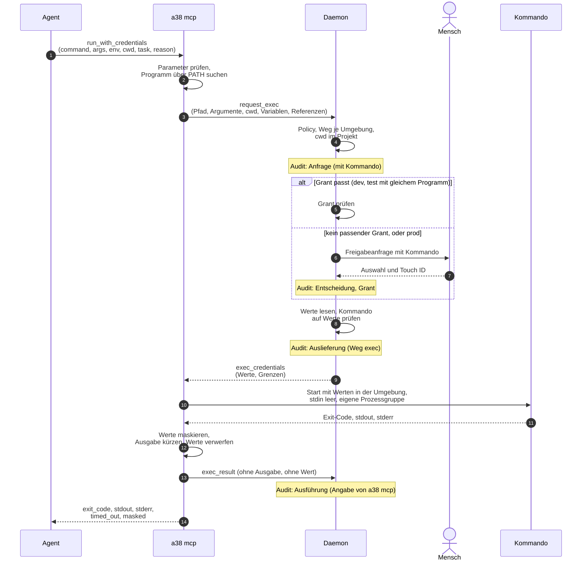

# UC15 — Ein Agent führt ein Kommando mit Zugangsdaten aus, ohne den Wert zu sehen

{{ design_kopf(page) }}

**Akteure:** Agent, `a38 mcp`, Daemon, Mensch, Kommando.

**Auslöser:** Der Agent braucht für ein Kommando ein Zugangsdatum, zum Beispiel ein Passwort für `psql` gegen eine Datenbank in test.

**Einsatzfall:** lokal ({{ ref("D60") }}). Der Vertrag gilt später auch in der VM ({{ ref("G35") }}).

**Ablauf:**

1. Der Agent ruft `run_with_credentials` auf ({{ ref("D61") }}).
2. `a38 mcp` prüft die Parameter und bildet den absoluten Pfad des Programms. Ein Fehler endet mit `invalid_request`, ohne Anfrage an den Daemon.
3. `a38 mcp` sendet `request_exec`. Die Anfrage bildet ein eigenes Bündel.
4. Der Daemon prüft die Policy ({{ ref("D28") }}), den Weg je Umgebung ({{ ref("D62") }}) und das Arbeitsverzeichnis ({{ ref("D64") }}). Er schreibt die Anfrage mit dem Kommando in das Audit-Log ({{ ref("D65") }}).
5. Gilt ein passender Grant ({{ ref("D63") }}), geht es mit Schritt 7 weiter.
6. Sonst zeigt der Daemon die Freigabeanfrage mit dem Kommando ({{ ref("D65") }}). In prod gilt die Freigabe nur für dieses eine Kommando.
7. Der Daemon liest die Werte. Enthält das Kommando einen der Werte, lehnt er mit `invalid_request` ab. Sonst schreibt er die Auslieferung und sendet `exec_credentials`.
8. `a38 mcp` startet das Kommando, maskiert und kürzt die Ausgabe ({{ ref("D64") }}) und meldet das Ergebnis ohne Ausgabe an den Daemon.
9. Der Agent erhält Exit-Code und Ausgabe.

**Abweichungen:**

- Der Agent ruft `request_credentials` für einen Vault aus test oder prod auf. Er erhält `exec_required` ohne Freigabeanfrage und stellt die Aufgabe mit `run_with_credentials` neu ({{ ref("D68") }}).
- prod ist in der Konfiguration ausgeschaltet. Der Agent erhält `not_allowed` ohne Freigabeanfrage.
- Der Mensch lehnt ab, oder die Zeit läuft ab: `denied` oder `timeout`, kein Start ({{ ref("D35") }}).
- Das Kommando überschreitet die Zeitgrenze: `a38 mcp` beendet die Prozessgruppe; das Ergebnis hat `timed_out: true`.
- Das Kommando endet mit einem Exit-Code ungleich 0: ein normales Ergebnis, kein Fehler von `a38`.

**Ergebnis:** Das Kommando lief mit dem Zugangsdatum. Der Agent kennt Exit-Code und maskierte Ausgabe, nicht den Wert. Das Audit-Log nennt Kommando, Zugangsdatum und Ergebnis.

**Grenze:** Der Agent wählt das Kommando. Ein Kommando wie `printenv` gibt den Wert aus; die Maskierung erkennt nur den exakten Wert ({{ ref("RI13") }}). Der Mensch sieht das Kommando in der Freigabeanfrage, außer ein Grant passt.
