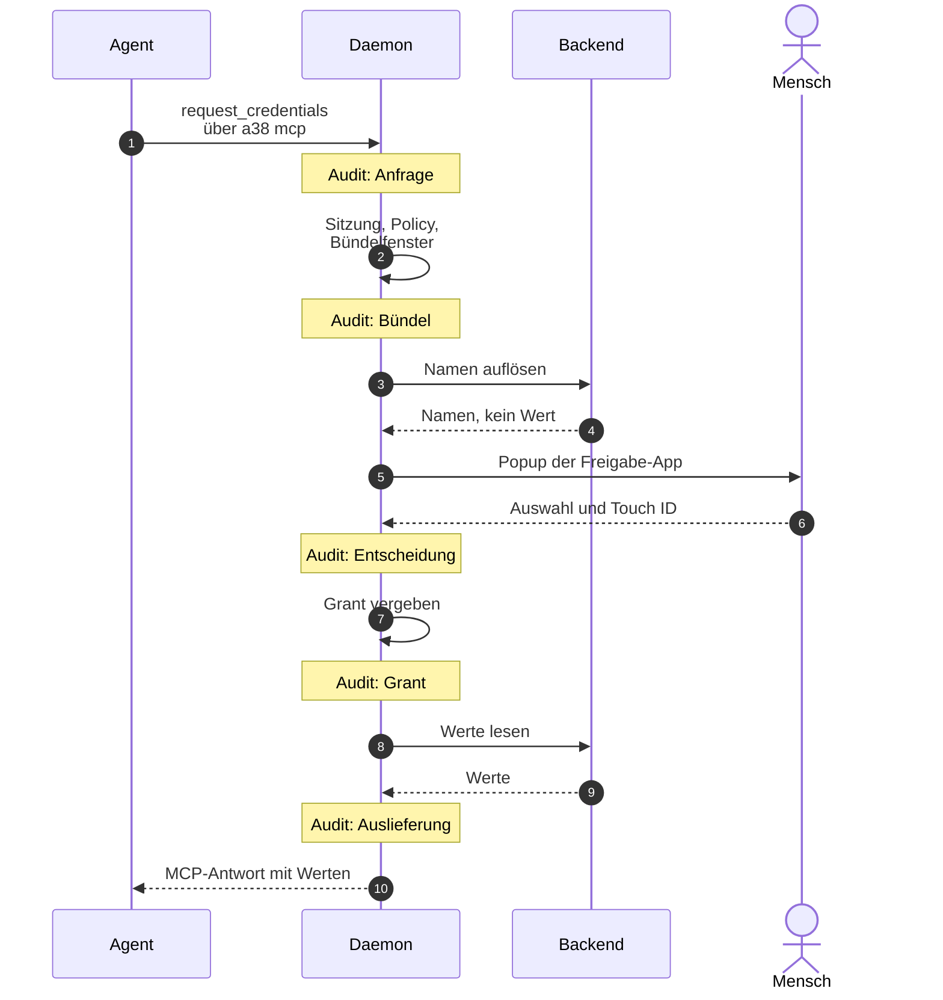

# UC1 — Ein Agent fordert Zugangsdaten an und erhält sie nach der Freigabe

{{ design_kopf(page) }}

**Akteure:** Agent, Daemon, Mensch.

**Auslöser:** Der Agent braucht Zugangsdaten für seine Aufgabe, zum Beispiel für eine Datenbank der Entwicklungsumgebung.

**Vorbedingung:** Der Daemon läuft. Die Sitzung hat keinen passenden Grant.

**Ablauf:**

1. Der Agent ruft das MCP-Werkzeug `request_credentials` auf. Er nennt die Zugangsdaten als Referenzen und gibt seine Aufgabe und eine Begründung an ({{ ref("D41") }}, {{ ref("D27") }}).
2. `a38 mcp` sendet die Anfrage über den Agent-Socket an den Daemon ({{ ref("D3") }}).
3. Der Daemon ordnet die Anfrage einer Sitzung zu ({{ ref("D25") }}).
4. Der Daemon prüft die Anfrage gegen die Policy ({{ ref("D28") }}).
5. Der Daemon sammelt weitere Anfragen der Sitzung für die Dauer des Bündelfensters ({{ ref("D29") }}).
6. Der Daemon löst die Namen der Vaults und Items im Backend auf. Er liest dabei keinen Secret-Wert ({{ ref("D34") }}).
7. Der Daemon startet die Freigabe. Die Freigabeanfrage zeigt oben die geprüften Fakten und unten die Angaben des Agents ({{ ref("D4") }}).
8. Der Mensch wählt die Zugangsdaten aus und bestätigt mit Touch ID ({{ ref("D7") }}).
9. Der Daemon vergibt einen Grant für die Sitzung ({{ ref("D8") }}).
10. Der Daemon liest die Werte im Backend und liefert sie als MCP-Antwort aus ({{ ref("D9") }}).
11. Der Daemon schreibt jedes Ereignis in das Audit-Log, sobald es eintritt, und die Auslieferung vor der Antwort ({{ ref("D11") }}, {{ ref("D36") }}).

**Ergebnis:** Der Agent hat die freigegebenen Werte. Das Audit-Log enthält Anfrage, Bündel, Entscheidung, Grant und Auslieferung.

**Abweichungen:** Ablehnung und Zeitüberschreitung ({{ ref("UC4") }}), Fehler ({{ ref("UC14") }}), Anfrage außerhalb von dev ({{ ref("UC5") }}).
