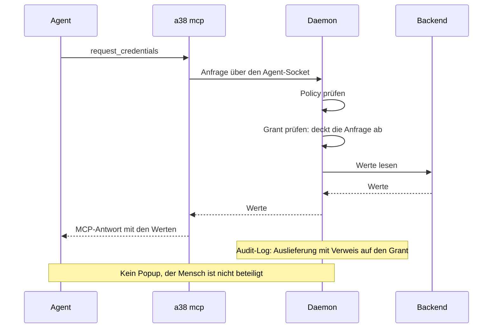

# UC2 — Ein Agent fordert Zugangsdaten im Rahmen eines Grants an und erhält sie ohne Popup

{{ design_kopf(page) }}

**Akteure:** Agent, Daemon.

**Auslöser:** Der Agent braucht Zugangsdaten erneut oder braucht weitere Zugangsdaten.

**Vorbedingung:** Die Sitzung hat einen gültigen Grant. Der Grant deckt die Anfrage ab.

**Ablauf:**

1. Der Agent fragt an wie in {{ ref("UC1") }}.
2. Der Daemon prüft die Policy und den Grant ({{ ref("D8") }}, {{ ref("D32") }}).
3. Der Daemon liefert die Werte ohne Freigabeanfrage aus.
4. Der Daemon schreibt die Auslieferung mit dem Verweis auf den Grant in das Audit-Log.

**Ergebnis:** Der Mensch sieht kein Popup. Die Auslieferung ist im Audit-Log nachvollziehbar.
