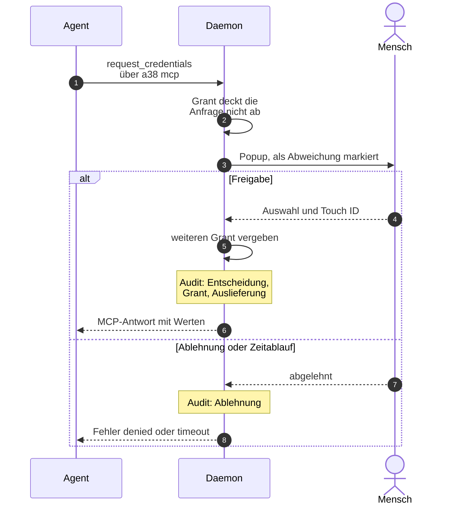

# UC3 — Ein Agent fordert Zugangsdaten außerhalb seines Grants an

{{ design_kopf(page) }}

**Akteure:** Agent, Daemon, Mensch.

**Auslöser:** Der Agent braucht Zugangsdaten, die sein Grant nicht abdeckt.

**Vorbedingung:** Die Sitzung hat einen gültigen Grant.

**Ablauf:**

1. Der Agent fragt an wie in {{ ref("UC1") }}.
2. Der Daemon stellt fest, dass der Grant die Anfrage nicht abdeckt.
3. Der Daemon startet eine Freigabe. Die Freigabeanfrage ist als Abweichung markiert. Sie nennt den bestehenden Grant und zeigt nur die neuen Zugangsdaten ({{ ref("D8") }}).
4. Der Mensch entscheidet wie in {{ ref("UC1") }}.
5. Bei einer Freigabe entsteht ein weiterer Grant für die Sitzung. Der bestehende Grant bleibt unverändert.

**Ergebnis:** Eine Abweichung fällt dem Menschen auf. Sie sieht anders aus als eine erste Anfrage.
