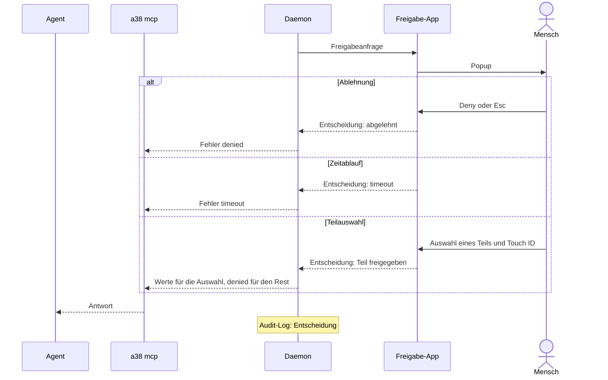

# UC4 — Der Mensch lehnt eine Anfrage ab oder reagiert nicht

{{ design_kopf(page) }}

**Akteure:** Mensch, Daemon, Agent.

**Auslöser:** Eine Freigabeanfrage ist sichtbar.

**Ablauf:**

1. Der Mensch lehnt ab, oder die Wartezeit der Freigabe läuft ab ({{ ref("D30") }}).
2. Der Daemon vergibt keinen Grant und liefert keinen Wert aus.
3. Der Agent erhält einen Fehler mit einem stabilen Code: `denied` oder `timeout` ({{ ref("D35") }}).
4. Der Daemon schreibt die Entscheidung in das Audit-Log.

**Ergebnis:** Der Agent weiß, dass er stoppen muss. Die Anleitung für Agents sagt: nach einer Ablehnung nicht umgehen ({{ ref("D22") }}).

**Abweichung:** Der Mensch wählt nur einen Teil der Zugangsdaten. Der Agent erhält die freigegebenen Werte und für jeden anderen Eintrag den Code `denied`.
