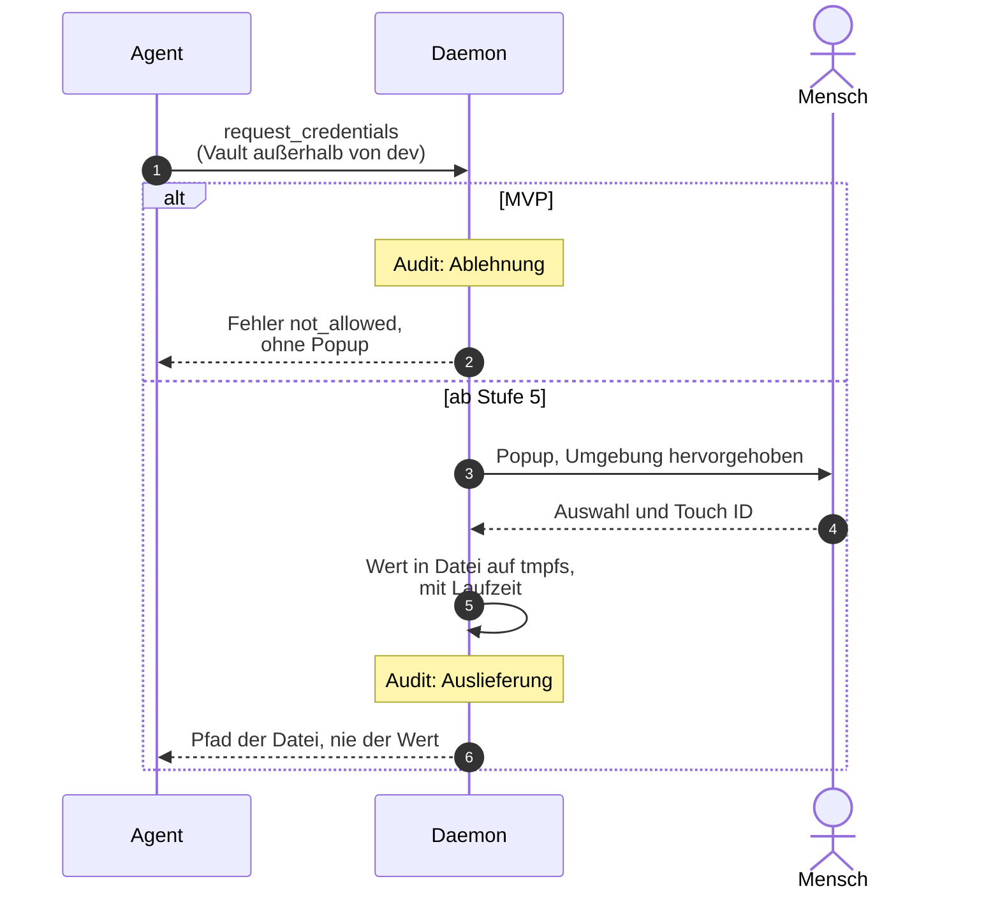

# UC5 — Ein Agent fordert Zugangsdaten außerhalb von dev an

{{ design_kopf(page) }}

**Akteure:** Agent, Daemon, Mensch.

**Auslöser:** Der Agent braucht Zugangsdaten aus einem Vault, der nicht zur Umgebung dev gehört.

**Ablauf im MVP:** Der Daemon lehnt die Anfrage ohne Freigabeanfrage ab. Der Agent erhält den Code `not_allowed`. Der Daemon schreibt die Ablehnung in das Audit-Log ({{ ref("D24") }}).

**Ablauf ab Stufe 5:**

1. Der Daemon startet eine Freigabe. Die Freigabeanfrage hebt die Umgebung hervor.
2. Nach der Freigabe schreibt der Daemon den Wert in eine Datei auf einem tmpfs. Die Datei hat eine Laufzeit ({{ ref("D10") }}).
3. Der Agent erhält den Pfad der Datei, nie den Wert.

**Ergebnis:** Ein Wert außerhalb von dev steht nie in einer MCP-Antwort.

**Offen:** Der Ablauf mit der Datei ist nicht entworfen ({{ ref("G11") }}).
