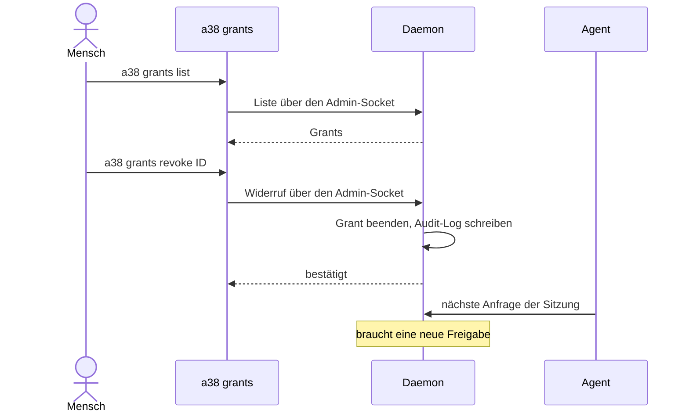

# UC7 — Der Mensch widerruft einen Grant

{{ design_kopf(page) }}

**Akteure:** Mensch, Daemon.

**Auslöser:** Der Mensch will einen Grant vor dem Ende der Laufzeit beenden.

**Ablauf:**

1. Der Mensch ruft `a38 grants list` auf.
2. Der Mensch ruft `a38 grants revoke <id>` auf.
3. Der Befehl spricht mit dem Daemon über den Admin-Socket ({{ ref("D44") }}).
4. Der Daemon beendet den Grant und schreibt den Widerruf in das Audit-Log.

**Ergebnis:** Die nächste Anfrage der Sitzung braucht eine neue Freigabe. Ein schon ausgelieferter Wert bleibt beim Agent ({{ ref("RI11") }}).
