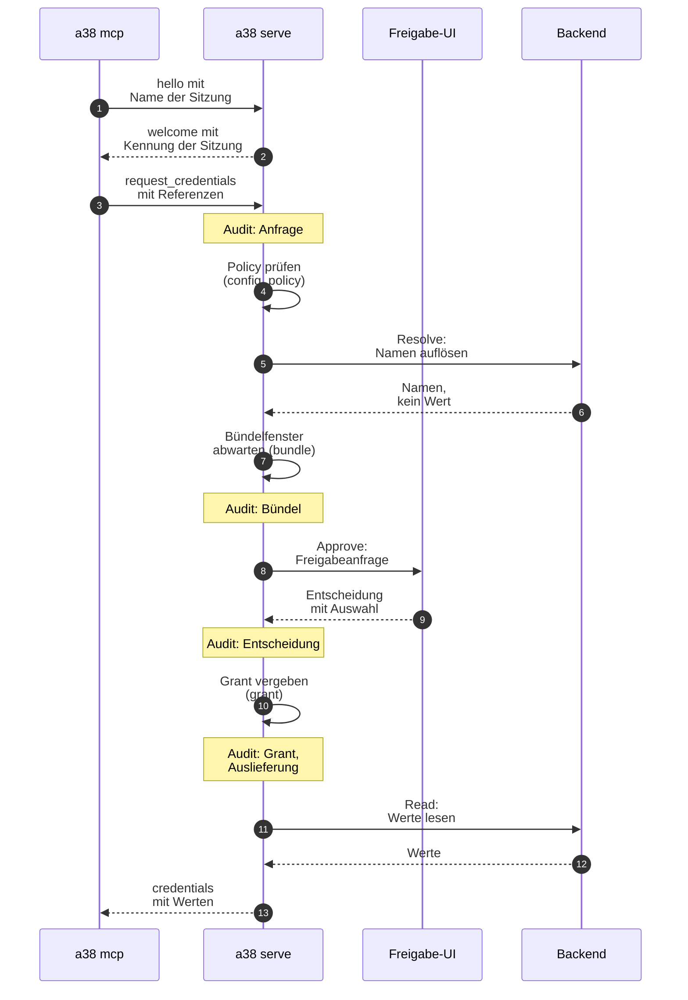

# Architektur

Diese Seite beschreibt den Aufbau des Codes von `a38` für die Stufe 1.
Die verbindlichen Aussagen stehen im [Design-Set](../design/index.md).
Diese Seite zeigt, wie der Code das Design umsetzt und wo welche Aufgabe liegt.

Das Ziel des Aufbaus: Mehrere Entwickler bauen die Teile gleichzeitig.
Kein Teil erfindet einen gemeinsamen Typ selbst.
Kein Entwickler ändert die Datei eines anderen Teils.

## Bestandteile und Prozesse

`a38` ist ein Binary mit Unterbefehlen ({{ ref("D42") }}).
Drei Arten von Prozessen entstehen daraus.

| Prozess | Zone | Aufgabe |
|---|---|---|
| `a38 serve` | Daemon | Der Prozess stellt den Agent-Socket und den Admin-Socket bereit. Er prüft die Policy, bündelt, fragt die Freigabe an, vergibt Grants, schreibt das Audit-Log und liefert aus. Nur dieser Prozess spricht mit dem Backend ({{ ref("D1") }}). |
| `a38 mcp` | Agent | Der Prozess ist ein MCP-Server über stdio (MCP: Model Context Protocol). Das Agent-Werkzeug startet ihn je Sitzung. Er übersetzt die zwei MCP-Werkzeuge in Nachrichten für den Agent-Socket ({{ ref("D41") }}). Er enthält keinen Code für ein Backend. |
| Admin-Befehle | Mensch | `a38 grants` und `a38 doctor` sprechen mit dem Daemon über den Admin-Socket ({{ ref("D44") }}). `a38 audit` liest die Audit-Datei direkt. `a38 llm` und `a38 version` brauchen keinen Daemon. |

Die Freigabe-UI ist in Stufe 1 kein eigener Prozess der Auslieferung.
Die Varianten `auto-approve` und `auto-deny` laufen im Daemon.
Die Variante `script` startet ein Skript als Kindprozess ({{ ref("D40") }}).
Die Freigabe-App in Swift folgt in Stufe 2 hinter derselben Schnittstelle.

Die Unterbefehle `tui` und `service` aus {{ ref("D42") }} gehören zu späteren Stufen.
Das Binary kennt sie noch nicht.

## Pakete

Jede Zeile nennt ein Paket, seinen Inhalt und das Issue, dem das Paket gehört.
„Fertig“ heißt: Dieses Issue liefert das Paket vollständig mit Tests.
„Schnittstelle“ heißt: Dieses Issue liefert nur Typen und Schnittstellen.

### Vorhandene Pakete

| Paket | Inhalt | Stand | Issue |
|---|---|---|---|
| `cmd/a38` | Liste der Unterbefehle in `main.go`. Jeder Unterbefehl hat eine eigene Datei mit genau einer Funktion. | Stubs | 16 |
| `internal/protocol` | Nachrichten beider Sockets, strenge Dekodierung, Fehlercodes, Referenz, Behälter für Secret-Werte | fertig | 16 |
| `internal/config` | Konfigurationsdatei: Struktur, Laden, Prüfen, Standardpfade | fertig | 16 |
| `internal/clock` | Uhr als Schnittstelle, mit echter und gefälschter Uhr | fertig | 16 |
| `internal/session` | geprüfte Fakten und Angaben des Agents als Typen | fertig | 16 |
| `internal/backend` | Schnittstelle `Backend`, Fehlerzustände, Zuordnung zu den Fehlercodes | Schnittstelle | 16 |
| `internal/approval` | Freigabeanfrage, Entscheidung, Meldung, Schnittstelle `UI` | Schnittstelle | 16 |
| `internal/audit` | Ereignisarten, Eintrag, Filter, Schnittstelle `Store` | Schnittstelle | 16 |
| `internal/daemon` | Naht zwischen Socket-Schicht und Broker: `AgentHandler`, `AdminHandler` | Schnittstelle | 16 |
| `internal/version` | Version des Binarys | fertig | – |

### Pakete der Folge-Issues

Die Namen dieser Pakete sind ein Vorschlag.
Der Besitzer eines Issues darf sein Paket anders schneiden.
Die Abhängigkeitsregel gilt in jedem Fall.

| Paket | Inhalt | Issue |
|---|---|---|
| `internal/audit/sqlite` | `Store` mit SQLite und Hash-Kette; `cmd/a38/audit.go` | 17 |
| `internal/backend/fake` | `Backend` aus einer YAML-Datei, mit Zählern und den Zuständen „gesperrt“ und „nicht erreichbar“ | 18 |
| `internal/approval/fakeui` | `UI` für `auto-approve`, `auto-deny` und `script` | 19 |
| `internal/approval/queue` | Warteschlange und Wartezeit: höchstens eine Freigabeanfrage zur gleichen Zeit | 19 |
| `internal/daemon` | Sockets, Rechte, Peer-Daten, Sitzungen, Namenskonflikt, Start und Ende; `cmd/a38/serve.go` | 20 |
| `internal/policy` | Prüfung einer Anfrage gegen die Konfiguration | 21 |
| `internal/bundle` | Bündelfenster und Obergrenze je Sitzung | 21 |
| `internal/grant` | Grants im Arbeitsspeicher: Vergabe, Prüfung, Ablauf, Widerruf | 22 |
| `internal/broker` | Ablauf einer Anfrage von der Policy bis zur Auslieferung; setzt `AgentHandler` und `AdminHandler` um | 22 |
| `internal/fault` | globale Sperre bei einer Störung, Meldung an den Menschen, Aufheben; die Schnittstellen `Gate` und `Lock` entstehen mit Issue 21 und 22 | 23 |
| `internal/mcp` | MCP-Server und Client für den Agent-Socket; `cmd/a38/mcp.go` | 24 |
| `internal/admin` | Client für den Admin-Socket; `cmd/a38/grants.go` | 25 |
| `internal/doctor` | Prüfungen von `a38 doctor`; `cmd/a38/doctor.go` | 25 |
| `internal/skill` | eingebettete Anleitung für Agents; `cmd/a38/llm.go` | 26 |

Vier Pakete aus dem ersten Entwurf entstehen in diesem Issue nicht: `internal/grant`, `internal/policy`, `internal/bundle` und ein Sitzungsregister.
Kein anderes Paket braucht heute einen Typ aus ihnen.
Die Liste der Grants auf dem Socket ist ein Typ des Protokolls (`protocol.Grant`).
Das Sitzungsregister gehört zur Socket-Schicht.
`internal/session` enthält deshalb nur die Datentypen.

### Naht im Daemon

Der Daemon hat zwei Hälften.
Die Socket-Schicht nimmt Verbindungen an und prüft Nachrichten (Issue 20).
Der Broker entscheidet über eine Anfrage (Issues 21 bis 23).
Die zwei Hälften kennen einander nur über die Schnittstellen `AgentHandler` und `AdminHandler` im Paket `internal/daemon`.

- Die Socket-Schicht ruft den Broker nur mit einer gültigen Nachricht einer angemeldeten Sitzung auf.
- Die Socket-Schicht behandelt den Namenskonflikt zweier Sitzungen selbst ({{ ref("D25") }}). Der Broker sieht eine Sitzung im Konflikt nicht.
- Der Broker gibt eine Antwort oder einen `*protocol.Error` zurück. Der Typ erzwingt einen stabilen Code für jeden Fehlerweg ({{ ref("D35") }}).
- Die Socket-Schicht meldet dem Broker das Ende einer Sitzung. Der Broker beendet dann die Grants der Sitzung ({{ ref("D33") }}).

Ein Test der Socket-Schicht nutzt einen gefälschten Broker.
Ein Test des Brokers braucht keinen Socket.

## Abhängigkeitsregel

Ein Paket importiert nur Pakete, die in dieser Tabelle in seiner Zeile stehen.
Die Standardbibliothek ist immer erlaubt.

| Paket | darf importieren |
|---|---|
| `protocol`, `clock`, `version` | kein Paket von `a38` |
| `config` | `protocol` |
| `session` | kein Paket von `a38` |
| `backend` | `protocol` |
| `approval` | `protocol`, `config`, `session` |
| `audit` | `protocol`, `session` |
| Umsetzung einer Schnittstelle (`backend/fake`, `audit/sqlite`, `approval/fakeui`, `approval/queue`) | das eigene Schnittstellenpaket und dessen erlaubte Pakete, dazu `clock` |
| `policy`, `bundle`, `grant`, `fault` | `protocol`, `config`, `session`, `clock`, dazu die Schnittstellenpakete `approval` und `audit` |
| `broker` | alle Pakete oberhalb dieser Zeile, aber nur die Schnittstellenpakete und keine Umsetzung |
| `daemon` | alle Pakete oberhalb dieser Zeile; nur `daemon` wählt die Umsetzungen aus |
| `mcp`, `admin` | `protocol`, `config`, `version` |
| `doctor` | `protocol`, `config`, `admin`, `audit` |
| `skill` | `protocol` |
| `cmd/a38` | jedes Paket |

Vier Regeln folgen aus der Tabelle:

1. `protocol` ist das gemeinsame Vokabular. Es importiert nichts von `a38`.
2. Kein Paket importiert eine Umsetzung eines anderen Pakets. Nur `daemon` und `cmd/a38` verdrahten Umsetzungen.
3. `mcp` importiert weder `backend` noch `daemon`. Der linux-Build von `a38 mcp` enthält so keinen Code für 1Password ({{ ref("D2") }}, {{ ref("T13") }}).
4. Kein Paket ruft `time.Now`, `time.After` oder `time.NewTimer` direkt auf. Es erhält eine `clock.Clock`.

## Datenfluss einer Anfrage

Das Diagramm zeigt {{ ref("UC1") }} mit den Paketen.
Der Agent ruft das MCP-Werkzeug `request_credentials` in `a38 mcp` auf.
Die Notizen nennen die Einträge im Audit-Log.



Vier Punkte sind für den Code wichtig:

- Die Policy-Prüfung steht vor dem Backend. Eine Anfrage außerhalb der Policy erreicht weder das Backend noch den Menschen ({{ ref("D28") }}, {{ ref("T3") }}).
- Der Eintrag für die Auslieferung steht vor dem Lesen der Werte ({{ ref("D36") }}). Schlägt `Append` fehl, ruft der Broker `Read` nicht auf ({{ ref("T26") }}).
- Der Broker hält einen Wert nur für die Antwort ({{ ref("D34") }}). Der Typ `protocol.Secret` gibt den Wert in keiner Textausgabe aus.
- Der Broker löst die Namen gleich nach der Policy auf, noch vor dem Bündelfenster. So endet ein unbekanntes Item sofort mit `not_found` und belegt keinen Platz im Bündel ({{ ref("D27") }}).
- Deckt ein Grant die Anfrage ab, entfallen Bündelfenster, Freigabe und Grant ({{ ref("UC2") }}). Die Auflösung der Namen bleibt: Der Grant gilt für die Namen des Backends.

## Broker

Die Issues 21 und 22 setzen den Broker um.
Fünf Pakete teilen sich die Arbeit:

| Paket | Inhalt |
|---|---|
| `internal/policy` | Prüfung einer Anfrage gegen die Konfiguration, alles oder nichts |
| `internal/bundle` | Bündelfenster mit festem Ende, Obergrenze, Reihenfolge des Eingangs |
| `internal/grant` | Grants im Arbeitsspeicher: Abdeckung, Ablauf, Ende mit der Sitzung, Widerruf |
| `internal/fault` | Schnittstellen `Gate` und `Lock` der globalen Sperre; `NoLock` sperrt nie |
| `internal/broker` | Ablauf einer Anfrage; setzt `AgentHandler` und `AdminHandler` um |

`policy`, `bundle` und `grant` sind reine Datenstrukturen.
Sie sind nicht nebenläufig sicher.
Der Broker hält seine Sperre, wenn er sie nutzt.

### Ablauf und Invarianten

1. Die globale Sperre ist offen. Sonst endet die Anfrage mit `daemon_faulted`.
2. Die Anfrage ist gültig. Der Broker schreibt das Ereignis „Anfrage“.
3. Die Policy erlaubt jede Referenz. Sonst endet die ganze Anfrage mit `not_allowed` oder `config_invalid`.
4. Das Backend löst jede Referenz auf. Ein Fehler beendet die ganze Anfrage.
5. Ein Grant der Sitzung deckt die Referenz ab, oder die Referenz kommt in das Bündel der Sitzung.
6. Am Ende des Fensters entsteht genau eine Freigabeanfrage. Der Broker prüft die Entscheidung selbst.
7. Eine Freigabe erzeugt einen Grant für die angehakten Einträge.
8. Der Broker prüft unter seiner Sperre den Grant und schreibt das Ereignis „Auslieferung“. Erst danach liest er die Werte.

Drei Regeln gelten auf jedem Weg:

- Ein Wert verlässt den Broker nur für eine Referenz, die ein lebender Grant derselben Sitzung im Moment der Auslieferung abdeckt.
- Ein Grant existiert erst, wenn sein Ereignis im Audit-Log steht.
- Ein Fehler der ganzen Anfrage liefert keinen Wert, auch nicht für eine Referenz unter einem Grant.

Der Broker schreibt ein Ereignis, das Grants ändert oder nutzt, unter seiner Sperre.
Die Reihenfolge im Audit-Log ist so die Reihenfolge der Änderungen.
Ein Widerruf steht vor einer Auslieferung, oder die Auslieferung steht vor dem Widerruf.

### Ereignisse je Ausgang

| Ausgang | Ereignisse | Code |
|---|---|---|
| Freigabe | Anfrage, Bündel, Entscheidung, Grant, Auslieferung | – |
| Teilauswahl | Anfrage, Bündel, Entscheidung, Grant, Ablehnung, Auslieferung | `denied` je nicht angehaktem Eintrag |
| Grant deckt ab | Anfrage, Auslieferung mit dem Grant | – |
| Policy | Anfrage, Ablehnung | `not_allowed`, `config_invalid` |
| Unbekanntes Item oder Feld | Anfrage, Ablehnung | `not_found` |
| Bündel voll | Ablehnung der überzähligen Einträge | `bundle_too_large` |
| Ablehnung durch den Menschen | Anfrage, Bündel, Ablehnung | `denied` |
| Wartezeit abgelaufen | Anfrage, Bündel, Ablauf | `timeout` |
| Fehler der Freigabe | Anfrage, Bündel, Fehler | `ui_failed` |
| Fehler des Backends | Anfrage, Fehler | `backend_locked`, `backend_unavailable` |
| Sitzung endet während der Freigabe | Ablauf mit `session_ended` | – |
| Ende eines Grants | Ablauf mit `lifetime_ended` oder `session_ended`, Widerruf | – |

### Was der Daemon verdrahtet

- `broker.New(cfg, backend, ui, auditStore, clock, logger)` erstellt den Broker.
- Die UI ist eine `approval/queue.Queue`. Sie setzt die Wartezeit von {{ ref("D30") }} durch. Der Broker lässt zusätzlich nur eine Freigabeanfrage zur gleichen Zeit zu.
- `Broker.Run(ctx)` entfernt abgelaufene Grants alle 30 Sekunden und schreibt ihr Ereignis. Ohne `Run` gilt ein Grant trotzdem nie über seine Laufzeit hinaus; das Ereignis entsteht dann bei der nächsten Anfrage.
- `broker.WithLock` setzt die globale Sperre. Bis Issue 23 ist es `fault.NoLock`. Der Broker ruft `Lock.Raise` bei jedem Fehler des Audit-Logs auf.

## Protokoll auf den Sockets

Das Paket `internal/protocol` setzt {{ ref("D26") }} um.
Eine Nachricht ist ein JSON-Objekt auf einer Zeile (JSON: JavaScript Object Notation).
Jede Nachricht trägt `version` und `type`.
Die Version ist `1`.

### Nachrichten des Agent-Sockets

| Anfrage | Antwort | Inhalt |
|---|---|---|
| `hello` | `welcome` | Erste Nachricht einer Verbindung. Sie nennt den Namen der Sitzung und den Namen des Agent-Werkzeugs. Beide sind Angaben des Agents. Die Antwort nennt die Kennung der Sitzung und das Projekt. |
| `request_credentials` | `credentials` | Die Anfrage nennt Referenzen, Aufgabe und Begründung. Die Antwort hat je Referenz einen Wert oder einen Fehler. |
| `grant_status` | `grants` | Grants der eigenen Sitzung ohne Werte |

### Nachrichten des Admin-Sockets

| Anfrage | Antwort | Inhalt |
|---|---|---|
| `grants_list` | `grants` | Grants aller Sitzungen |
| `grant_revoke` | `grant_revoked` | Widerruf eines Grants |
| `status` | `status_result` | Zustand des Daemons für `a38 doctor`: Störung, ungültige Projekte, Zahl der Sitzungen und Grants |
| `fault_clear` | `fault_clear_result` | Aufheben der globalen Sperre ({{ ref("D48") }}) |

Scheitert eine Anfrage als Ganzes, ist die Antwort auf beiden Sockets die Nachricht `error` mit Code und Text.

### Regeln

- Jede Anfrage außer `hello` trägt eine Kennung `id`. Die Antwort wiederholt sie. Eine Sitzung hat im Bündelfenster mehrere offene Anfragen; die Kennung ordnet die Antworten zu.
- Jeder Socket hat eine eigene Menge von Nachrichten: `protocol.AgentRequests`, `protocol.AgentResponses`, `protocol.AdminRequests` und `protocol.AdminResponses`. Eine Admin-Nachricht auf dem Agent-Socket ist ein unbekannter Typ und endet mit `invalid_request` ({{ ref("T12") }}, {{ ref("T28") }}).
- `Set.Decode` lehnt ab: eine Zeile über 64 KiB, kein JSON-Objekt, eine falsche Version, einen unbekannten Typ, ein unbekanntes Feld, einen Schlüssel mit Großbuchstaben, einen doppelten Schlüssel und einen ungültigen Inhalt ({{ ref("T10") }}).
- Der Text eines Fehlers der Dekodierung wiederholt nie den Inhalt der Zeile.
- `request_credentials` hat kein Feld für den Namen der Sitzung. Der Name steht je Verbindung fest ({{ ref("T21") }}).
- Ein Steuerzeichen im Namen der Sitzung ist immer ungültig. Die Länge und die erlaubten Zeichen prüft der Daemon mit `config.SessionNameRules.Check`.
- Der Daemon sendet den Code `daemon_unavailable` nie. Nur `a38 mcp` erzeugt ihn, wenn der Socket nicht erreichbar ist.

### Fehlercodes

Die Codes aus {{ ref("D35") }} sind Konstanten vom Typ `protocol.Code`.
`protocol.Codes()` liefert die vollständige Liste.
Der Test für die Anleitung der Agents nutzt diese Liste ({{ ref("T20") }}).
`protocol.Error` ist zugleich der Go-Fehler und das Fehlerobjekt auf dem Socket.

### Referenz und Secret-Wert

`protocol.Reference` ist die Referenz `op://<vault>/<item>/<feld>` aus {{ ref("D27") }}.
`ParseReference` verlangt genau drei Segmente.
Ein Segment ist nicht leer und enthält weder einen Schrägstrich noch ein Steuerzeichen.
Eine Referenz enthält den Text des Agents.
Die geprüften Namen liefert `Backend.Resolve`.

`protocol.Secret` hält einen Secret-Wert.
Die Pakete `fmt` und `log/slog` und `json.Marshal` geben statt des Werts `[redacted]` aus.
Nur `Secret.Reveal` liefert den Wert.
Nur `protocol.Encode` schreibt den Wert, und nur in die Nachricht `credentials` ({{ ref("D34") }}, {{ ref("T8") }}).

## Freigabe-Schnittstelle

Das Paket `internal/approval` beschreibt die Grenze zwischen Daemon und Freigabe-UI ({{ ref("D6") }}).

- `Request` ist die Freigabeanfrage. Sie trägt die geprüften Fakten (`verified`), die Angaben des Agents (`claims`), die Einträge, die vorgeschlagene Laufzeit und bei einer Abweichung den bestehenden Grant.
- `Decision` ist die Entscheidung: Ergebnis, ausgewählte Einträge, gewählte Laufzeit.
- `Notice` ist die Meldung an den Menschen bei einer Störung des Daemons ({{ ref("D48") }}, {{ ref("D36") }}) und bei der fehlerhaften Konfiguration eines Projekts ({{ ref("D28") }}). Sie informiert nur.
- `UI` hat zwei Methoden: `Approve` und `Notify`.

Der Daemon vertraut einer Entscheidung nicht.
Der Broker prüft die Kennung der Anfrage, die Auswahl und die Laufzeit.
Eine ungültige Freigabe endet mit `ui_failed` ({{ ref("D32") }}, {{ ref("T23") }}).

### Verhältnis zum Prototyp

Die JSON-Form folgt dem Prototyp aus dem [Spike zur Freigabe-UI](spikes/20-freigabe-ui.md).
Ein Test liest die Beispielanfragen des Prototyps mit den Typen dieses Pakets.
Die Abweichungen:

| Abweichung | Grund |
|---|---|
| `verified.session_id` ist neu. | Die geprüften Fakten nennen die Kennung des Daemons ({{ ref("T21") }}). |
| `verified.peer_uid` ist neu. | {{ ref("D25") }} nennt den Benutzer als Teil der Herkunft. |
| `claims.session_name` ist neu. | Der Name der Sitzung steht nur bei den Angaben ({{ ref("D25") }}). |
| `credentials[].field` ist neu. | Ein Grant gilt für ein Feld eines Items ({{ ref("D27") }}, {{ ref("D32") }}). Der Mensch sieht, welches Feld er freigibt. |
| `credentials[].deviation` kennt `outside_scope` nicht. | Eine Anfrage außerhalb der Policy erreicht die Freigabe nie ({{ ref("D28") }}). |
| `grant.scope` ist nur Anzeige. | Ein Grant umfasst genau die angehakten Zugangsdaten und keinen ganzen Vault ({{ ref("D32") }}, {{ ref("G7") }}). |
| `verified.vm_name` und `verified.ssh_session` fehlen. | Die Herkunft aus der VM gehört zur Stufe 5 ({{ ref("G1") }}). |
| Der Typ `notice` ist neu. | Der Prototyp kennt nur Anfrage und Entscheidung. Ob die Freigabe-App die Meldung zeigt, ist offen ({{ ref("G20") }}). |

Der Prototyp ignoriert unbekannte Felder.
Die neuen Felder brechen ihn deshalb nicht.

## Schnittstellen zu Backend und Audit-Log

`backend.Backend` hat drei Methoden: `Vaults`, `Resolve` und `Read` ({{ ref("D38") }}).
`Resolve` liest keinen Wert.
Die Fehlerzustände sind `ErrLocked`, `ErrUnavailable` und `ErrNotFound`.
`backend.Code` ordnet einen Fehler dem stabilen Code zu ({{ ref("T17") }}).

`audit.Store` hat die Methoden `Append`, `List` und `Verify` ({{ ref("D36") }}).
Der Daemon übergibt ein `audit.Event`.
Der Store ergänzt Nummer, Zeitpunkt und Hash.
Die kanonische Form eines Eintrags legt Issue 17 fest.
Ein Eintrag hält die geprüften Fakten und die Angaben des Agents in getrennten Feldern.

Beginn und Ende der globalen Sperre stehen als Ereignisart „Fehler“ im Audit-Log.
Das Feld `detail` trägt dann `fault_begin` oder `fault_end`.
{{ ref("D36") }} nennt dafür keine eigene Ereignisart.

## Konfigurationsdatei

Format und Ort legt {{ ref("D49") }} fest.
Die Datei ist YAML und liegt unter `~/.config/a38/config.yaml`.
Der Schalter `--config` und die Variable `A38_CONFIG` nennen einen anderen Pfad.

```yaml
version: 1
vaults:
  - name: beispiel.app.k8s-dev
    environment: dev
projects:
  - name: beispielprojekt
    paths:
      - ~/develop/beispielprojekt
      - ~/develop/beispielprojekt__worktrees
    vaults:
      - beispiel.app.k8s-dev
grant:
  lifetime: 4h
bundle:
  window: 3s
  max_entries: 10
session_name:
  max_length: 80
  allowed_characters: "ABCDEFGHIJKLMNOPQRSTUVWXYZabcdefghijklmnopqrstuvwxyz0123456789 -_():"
paths:
  socket_dir: ~/.local/state/a38/run
  audit_file: ~/.local/state/a38/audit.db
```

Nur `version` ist Pflicht.
Das Beispiel zeigt bei allen anderen Schlüsseln außer `vaults` und `projects` die Standardwerte.

| Regel | Folge | Beleg |
|---|---|---|
| Ein Vault ohne Umgebung oder mit einer anderen Umgebung als `dev`, `test`, `prod` | Das Laden scheitert. Die Meldung nennt den Vault. | {{ ref("D47") }}, {{ ref("T22") }} |
| Derselbe Vault zweimal | Das Laden scheitert. | {{ ref("T22") }} |
| Ein Projekt nennt einen Vault, der in der Liste der Vaults fehlt. | Das Laden gelingt. Das Projekt trägt den Befund im Feld `Invalid`. Der Daemon lehnt seine Anfragen mit `config_invalid` ab. | {{ ref("D28") }} |
| Laufzeit, Bündelfenster, Obergrenze oder Höchstlänge mit dem Wert 0, einem negativen Wert oder Text | Das Laden scheitert. | {{ ref("T4") }}, {{ ref("T19") }}, {{ ref("T21") }} |
| Ein unbekannter Schlüssel | Das Laden scheitert. | {{ ref("D49") }} |

`Config.ProjectFor` leitet das Projekt aus dem Arbeitsverzeichnis ab.
Der längste passende Pfad gewinnt.
Der Daemon löst symbolische Links vor dem Aufruf auf.
Der Daemon vergleicht den Namen eines Vaults genau, ohne Rücksicht auf Muster ({{ ref("D12") }}).

Der Daemon liest die Datei einmal beim Start.
Eine Änderung braucht einen Neustart.

## Kommandozeile

Die Unterbefehle nutzen das Paket `flag` der Standardbibliothek.
Eine Bibliothek für die Kommandozeile bringt für sieben Unterbefehle keinen Vorteil und wäre eine weitere Abhängigkeit im Binary des Daemons.

- `cmd/a38/main.go` enthält nur die Liste der Unterbefehle.
- Jeder Unterbefehl hat eine eigene Datei, zum Beispiel `cmd/a38/serve.go`, mit der Funktion `runServe(args, stdout, stderr) int`.
- Ein Unterbefehl ohne Code schreibt `not implemented` und endet mit dem Exit-Code 1.
- Ein Fehler im Aufruf endet mit dem Exit-Code 2.

Der Besitzer eines Unterbefehls ändert nur seine Datei.

## Teststrategie

Jeder Test nennt seinen Testfall im Kommentar, zum Beispiel `// T22 (part): ...`.
Die Tests sind tabellengetrieben.

| Mittel | Paket | Zweck |
|---|---|---|
| gefälschte Uhr | `clock.Fake` | Der Test stellt die Zeit mit `Advance` vor. Bündelfenster, Wartezeit der Freigabe und Laufzeit eines Grants brauchen keine echte Zeit ({{ ref("T2") }}, {{ ref("T4") }}, {{ ref("T19") }}). `BlockUntil` wartet, bis der Code seinen Timer gestartet hat. |
| Fake-Backend | `backend/fake` | Vaults aus einer YAML-Datei. Das Backend zählt Auflösungen und Lesezugriffe und stellt „gesperrt“ und „nicht erreichbar“ nach ({{ ref("T3") }}, {{ ref("T17") }}). |
| gefälschte Freigabe | `approval/fakeui` | `auto-approve`, `auto-deny` und `script`. Das Skript speichert die Freigabeanfrage und die Meldungen ({{ ref("T21") }}, {{ ref("T26") }}). |
| gefälschter Broker | Test in `daemon` | Die Socket-Schicht läuft ohne Policy, Grants und Audit-Log ({{ ref("T10") }}, {{ ref("T12") }}). |
| Fuzz-Test | `protocol` | `FuzzDecode` prüft, dass die Dekodierung bei keiner Eingabe abstürzt ({{ ref("T10") }}). |

Es gibt drei Ebenen von Tests:

1. **Paket-Test:** Der Test prüft ein Paket allein. Er nutzt die Fakes der Schnittstellen.
2. **Test im Prozess:** Der Test baut den Daemon im Testprozess zusammen: Socket in einem temporären Verzeichnis, Fake-Backend, Skript-UI, gefälschte Uhr. Die meisten Testfälle des Design-Sets laufen auf dieser Ebene, weil sie die gefälschte Uhr brauchen.
3. **Test mit Prozessen:** Der Test baut das Binary einmal je Testlauf in ein temporäres Verzeichnis. Er startet `a38 serve --backend fake --ui auto-approve` mit einer eigenen Konfigurationsdatei und danach `a38 mcp` als Kindprozesse. Er spricht MCP über stdin und stdout von `a38 mcp` ({{ ref("T1") }}). Diese Ebene nutzt die echte Uhr und deshalb kurze Werte in der Konfiguration, zum Beispiel ein Bündelfenster von 50 Millisekunden.

Regeln für einen Test mit Prozessen:

- Die Konfiguration nennt `paths.socket_dir` und `paths.audit_file` in einem temporären Verzeichnis. Der Pfad eines Sockets bleibt unter 103 Byte; unter macOS ist `t.TempDir()` dafür oft zu lang. Der Test legt das Verzeichnis dann unter `/tmp` an.
- Der Test wartet auf den Socket und nicht auf eine feste Zeit.
- Der Test beendet die Kindprozesse in `t.Cleanup`.
- Ein Kennwert im Fake-Backend zeigt, ob ein Secret-Wert in eine Ausgabe gelangt ({{ ref("T8") }}).

## Abhängigkeiten

Das Binary bleibt statisch (`CGO_ENABLED=0`).
Jede Abhängigkeit braucht einen Grund.

| Modul | Version | Zweck | Stand |
|---|---|---|---|
| `go.yaml.in/yaml/v3` | v3.0.6 | Konfigurationsdatei und Fake-Backend | in `go.mod` |
| `modernc.org/sqlite` | v1.62.0 | Audit-Log; SQLite in reinem Go, ohne cgo | Empfehlung für Issue 17 |
| `github.com/modelcontextprotocol/go-sdk` | v1.8.0 | MCP-Server über stdio; das offizielle Go-SDK | Empfehlung für Issue 24 |

`go.yaml.in/yaml` ist der gepflegte Nachfolger von `gopkg.in/yaml.v3`.
Die Version v4.0.0 ist eine Woche alt (Stand 2026-11-11).
Die Version v3 ist erprobt und reicht für beide Dateien.

Die zwei empfohlenen Module stehen noch nicht in `go.mod`.
Das Issue, das ein Modul braucht, nimmt es auf und prüft dabei die aktuelle Version.
`modernc.org/sqlite` gehört nur in den Daemon und in `a38 audit`.
Das MCP-SDK gehört nur in `internal/mcp`.

## Was diese Seite nicht entscheidet

- Die Form des Startwerts für den Namen der Sitzung, Argument oder Umgebungsvariable von `a38 mcp`, ist offen ({{ ref("G19") }}). Issue 24 legt sie fest.
- Der Name des Admin-Befehls zum Aufheben der Sperre ist offen ({{ ref("G20") }}). Das Protokoll nennt die Nachricht `fault_clear`. Issue 25 wählt den Namen auf der Kommandozeile.
- Ob die Freigabe-App die Meldung zeigt, ist offen ({{ ref("G20") }}). In Stufe 1 erhält das Skript der Oberfläche die Meldung.
- Ob ein Agent die Namen der Items über ein Werkzeug findet, ist offen ({{ ref("G6") }}). Das Protokoll hat dafür keine Nachricht. `Backend.Vaults` listet nur Vaults.
- Ob eine Verbindung je Agent die richtige Sitzung ist, ist offen ({{ ref("G2") }}). Der Code setzt {{ ref("D25") }} um.
