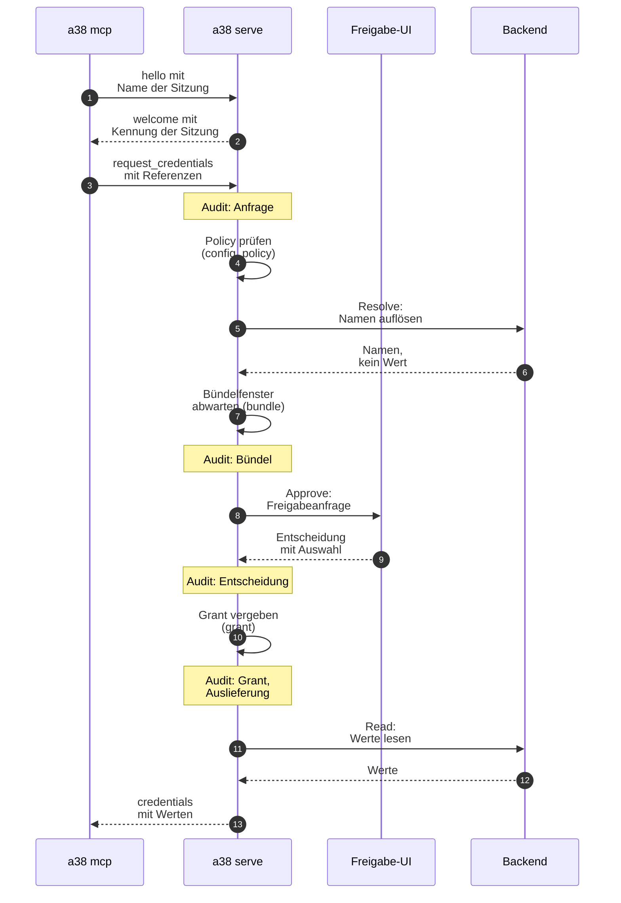

# Architektur

Diese Seite beschreibt den Aufbau des Codes von `a38` (Stufen 1 bis 3, Stand nach dem Release `v0.1.0`).
Die verbindlichen Aussagen stehen im [Design-Set](../design/index.md).
Diese Seite zeigt, wie der Code das Design umsetzt und wo welche Aufgabe liegt.

Das Ziel des Aufbaus: Mehrere Entwickler bauen die Teile gleichzeitig.
Kein Teil erfindet einen gemeinsamen Typ selbst.
Kein Entwickler ändert die Datei eines anderen Teils.

## Bestandteile und Prozesse

!!! note "Zielplattformen"
    Der Daemon `a38 serve` und die Freigabe-App „Passierschein“ laufen nur auf macOS ({{ ref("D53") }}).
    Linux ist nur Zielplattform für den Client `a38 mcp` in der VM des Agents.
    Unter Linux startet `a38 serve` nur mit dem Fake-Backend, für die Entwicklung und die CI.

`a38` ist ein Binary mit Unterbefehlen ({{ ref("D42") }}).
Drei Arten von Prozessen entstehen daraus.

| Prozess | Zone | Aufgabe |
|---|---|---|
| `a38 serve` | Daemon | Der Prozess stellt den Agent-Socket und den Admin-Socket bereit. Er prüft die Policy, bündelt, fragt die Freigabe an, vergibt Grants, schreibt das Audit-Log und liefert aus. Nur dieser Prozess spricht mit dem Backend ({{ ref("D1") }}). |
| `a38 mcp` | Agent | Der Prozess ist ein MCP-Server über stdio (MCP: Model Context Protocol). Das Agent-Werkzeug startet ihn je Sitzung. Er übersetzt die zwei MCP-Werkzeuge in Nachrichten für den Agent-Socket ({{ ref("D41") }}). Er verbindet sich erst beim ersten Aufruf eines Werkzeugs mit dem Daemon und sendet dann den Namen der Sitzung und den Namen des MCP-Clients in `hello`. Ist der Daemon nicht erreichbar, antwortet er mit `daemon_unavailable` und versucht es beim nächsten Aufruf erneut. Er enthält keinen Code für ein Backend. |
| Admin-Befehle | Mensch | `a38 grants`, `a38 fault` und `a38 doctor` sprechen mit dem Daemon über den Admin-Socket ({{ ref("D44") }}). `a38 audit` und `a38 tui` lesen die Audit-Datei direkt und nur lesend; `a38 tui` gibt es nur unter macOS ({{ ref("D57") }}). `a38 config onepassword-token` legt das Token des Service Accounts im Schlüsselbund ab ({{ ref("D51") }}). `a38 service` richtet den Daemon als LaunchAgent ein ({{ ref("D56") }}). `a38 llm` und `a38 version` brauchen keinen Daemon. |

Die Freigabe-UI hat vier Varianten hinter derselben Schnittstelle.
Die Varianten `auto-approve` und `auto-deny` laufen im Daemon.
Die Variante `script` startet ein Skript als Kindprozess ({{ ref("D40") }}).
Die Variante `app` startet die Freigabe-App „Passierschein“ in Swift als Kindprozess (`a38 serve --ui app`); Stefan hat sie abgenommen ([PR 46](https://github.com/seletz/passierschein/pull/46)).

## Pakete

Jede Zeile nennt ein Paket, seinen Inhalt und das Issue, dem das Paket gehört.
„Fertig“ heißt: Dieses Issue liefert das Paket vollständig mit Tests.
„Schnittstelle“ heißt: Dieses Issue liefert nur Typen und Schnittstellen.

### Vorhandene Pakete

| Paket | Inhalt | Stand | Issue |
|---|---|---|---|
| `cmd/a38` | Liste der Unterbefehle in `main.go`. Jeder Unterbefehl hat eine eigene Datei mit genau einer Funktion. | Stubs | 16 |
| `internal/protocol` | Nachrichten beider Sockets, strenge Dekodierung, Fehlercodes, Referenz, Behälter für Secret-Werte | fertig | 16 |
| `internal/config` | Konfigurationsdatei: Struktur, Laden, Prüfen, Standardpfade | fertig | 16 |
| `internal/clock` | Uhr als Schnittstelle, mit echter und gefälschter Uhr | fertig | 16 |
| `internal/session` | geprüfte Fakten und Angaben des Agents als Typen | fertig | 16 |
| `internal/backend` | Schnittstelle `Backend`, Fehlerzustände, Zuordnung zu den Fehlercodes | Schnittstelle | 16 |
| `internal/approval` | Freigabeanfrage, Entscheidung, Meldung, Schnittstelle `UI` | Schnittstelle | 16 |
| `internal/audit` | Ereignisarten, Eintrag, Filter, Schnittstelle `Store` | Schnittstelle | 16 |
| `internal/daemon` | Naht zwischen Socket-Schicht und Broker: `AgentHandler`, `AdminHandler` | Schnittstelle | 16 |
| `internal/version` | Version des Binarys | fertig | – |

### Pakete der Folge-Issues

Die Namen dieser Pakete sind ein Vorschlag.
Der Besitzer eines Issues darf sein Paket anders schneiden.
Die Abhängigkeitsregel gilt in jedem Fall.

| Paket | Inhalt | Issue |
|---|---|---|
| `internal/audit/sqlite` | `Store` mit SQLite und Hash-Kette; `cmd/a38/audit.go` | 17 |
| `internal/backend/fake` | `Backend` aus einer YAML-Datei, mit Zählern und den Zuständen „gesperrt“ und „nicht erreichbar“ | 18 |
| `internal/approval/fakeui` | `UI` für `auto-approve`, `auto-deny` und `script` | 19 |
| `internal/approval/appui` | `UI` für `--ui app`: startet die Freigabe-App als Kindprozess | 40 |
| `internal/approval/queue` | Warteschlange und Wartezeit: höchstens eine Freigabeanfrage zur gleichen Zeit | 19 |
| `internal/daemon` | Sockets, Rechte, Peer-Daten, Sitzungen, Namenskonflikt, Start und Ende; `cmd/a38/serve.go` | 20 |
| `internal/client` | Verbindung zu einem Socket des Daemons: `hello`, Anfrage senden, Antwort über die Kennung zuordnen. `internal/mcp` und die Admin-Befehle nutzen das Paket. | 20 |
| `internal/policy` | Prüfung einer Anfrage gegen die Konfiguration | 21 |
| `internal/bundle` | Bündelfenster und Obergrenze je Sitzung | 21 |
| `internal/grant` | Grants im Arbeitsspeicher: Vergabe, Prüfung, Ablauf, Widerruf | 22 |
| `internal/broker` | Ablauf einer Anfrage von der Policy bis zur Auslieferung; setzt `AgentHandler` und `AdminHandler` um | 22 |
| `internal/fault` | globale Sperre bei einer Störung, Meldung an den Menschen, Einträge im Audit-Log, Aufheben | 23 |
| `internal/mcp` | MCP-Server und Client für den Agent-Socket; `cmd/a38/mcp.go` | 24 |
| Admin-Befehle | `cmd/a38/admin.go`, `grants.go` und `fault.go` nutzen `internal/client` auf dem Admin-Socket; es gibt kein Paket `internal/admin` | 25 |
| `internal/doctor` | Prüfungen von `a38 doctor`; `cmd/a38/doctor.go` | 25 |
| `internal/skill` | eingebettete Anleitung für Agents; `cmd/a38/llm.go` | 26 |
| `internal/backend/onepassword` | `Backend` über das Go-SDK von 1Password mit einem Service Account; nur im macOS-Build von `a38` ([1Password-Backend](#1password-backend)) | 50 |
| `internal/token` | Typ `Token` mit der Ausgabe `[redacted]`; Schnittstellen `Source` und `Store`; Prüfung der Form eines Tokens | 50, 59 |
| `internal/tokenfile` | Token-Datei als Quelle (Ausweichweg für Entwicklung und CI): Prüfung von Besitzer und Rechten, Lesen | 50 |
| `internal/auditstats` | Kennzahlen aus den Einträgen des Audit-Logs (Popups, Ablehnungen, Abweichungen, Auslieferungen, Größe der Bündel, Rangfolgen), Sitzungen und Grants; reine Funktionen ohne Terminal und ohne Uhr; `Clean` entfernt Steuer- und Bidi-Zeichen für jede Ausgabe im Terminal ({{ ref("D57") }}) | 71 |
| `internal/tui` | Bubble-Tea-Modell von `a38 tui`: Übersicht, Ereignisse mit Filtern und Detail, Sitzungen mit Zeitleiste; liest über eine `Source` und schreibt nie; `cmd/a38/tui_darwin.go` startet es nur im macOS-Build | 71 |
| `internal/auditdemo` | synthetisches Audit-Log über den echten Store für Tests, Demo und Screenshots; das Programm `internal/auditdemo/gen` ist ein Werkzeug der Entwicklung und nicht Teil des Release | 71 |
| `internal/service` | LaunchAgent des Daemons: plist erzeugen und lesen, Vorprüfung, `launchctl` hinter einer Schnittstelle, Zustand; nur der macOS-Build von `a38` nutzt das Paket ([LaunchAgent](#launchagent)) | 70 |
| `internal/keychain` | ein Eintrag im Schlüsselbund von macOS über Security.framework mit `purego`, ohne cgo: anlegen, lesen, löschen, beschreiben; Signatur von `a38`; nur im macOS-Build | 59 |
| `internal/opguard` | Hook gegen den direkten Aufruf von `op`: Eingabe des Hooks lesen, Befehl mit einem Shell-Parser prüfen, Meldung für den Agent, Block für `settings.json`; `cmd/a38/hook.go` ([Hook gegen op](#hook-gegen-op)) | 78 |

Vier Pakete aus dem ersten Entwurf entstehen in diesem Issue nicht: `internal/grant`, `internal/policy`, `internal/bundle` und ein Sitzungsregister.
Kein anderes Paket braucht heute einen Typ aus ihnen.
Die Liste der Grants auf dem Socket ist ein Typ des Protokolls (`protocol.Grant`).
Das Sitzungsregister gehört zur Socket-Schicht.
`internal/session` enthält deshalb nur die Datentypen.

### Naht im Daemon

Der Daemon hat zwei Hälften.
Die Socket-Schicht nimmt Verbindungen an und prüft Nachrichten (Issue 20).
Der Broker entscheidet über eine Anfrage (Issues 21 bis 23).
Die zwei Hälften kennen einander nur über die Schnittstellen `AgentHandler` und `AdminHandler` im Paket `internal/daemon`.

- Die Socket-Schicht ruft den Broker nur mit einer gültigen Nachricht einer angemeldeten Sitzung auf.
- Die Socket-Schicht behandelt den Namenskonflikt zweier Sitzungen selbst ({{ ref("D25") }}). Der Broker sieht eine Sitzung im Konflikt nicht.
- Der Broker gibt eine Antwort oder einen `*protocol.Error` zurück. Der Typ erzwingt einen stabilen Code für jeden Fehlerweg ({{ ref("D35") }}).
- Die Socket-Schicht meldet dem Broker das Ende einer Sitzung. Der Broker beendet dann die Grants der Sitzung ({{ ref("D33") }}).

Ein Test der Socket-Schicht nutzt einen gefälschten Broker.
Ein Test des Brokers braucht keinen Socket.

### Socket-Schicht

Die Socket-Schicht setzt {{ ref("D43") }}, {{ ref("D25") }} und {{ ref("D44") }} so um:

- **Start:** Der Daemon legt das Verzeichnis der Sockets mit `0700` an. Hat das Verzeichnis andere Rechte, gehört es einem anderen Benutzer oder ist es ein symbolischer Link, startet der Daemon nicht. Der Daemon korrigiert die Rechte nicht.
- **Ein Daemon je Verzeichnis:** Der Daemon sperrt das Verzeichnis mit `flock`. Ein zweiter Daemon mit demselben Verzeichnis startet nicht.
- **Bereitschaft:** Der Daemon bindet jeden Socket unter einem temporären Namen im selben Verzeichnis, setzt den Modus `0600` und benennt die Datei erst um, wenn der Socket lauscht. Die Datei am endgültigen Pfad existiert also nur bei einem Socket, der Verbindungen annimmt. Ein Client, der die Datei sieht und sofort verbindet, wird nie abgewiesen. `removeStale` und die Sperre des Verzeichnisses bleiben unverändert.
- **Alter Socket:** Der Daemon entfernt einen Socket nur, wenn kein Prozess eine Verbindung annimmt. Eine Datei, die kein Socket ist, entfernt er nie.
- **Peer-Daten:** Der Kernel liefert Benutzer und Prozess-ID. Unter macOS liest der Daemon Programmpfad und Arbeitsverzeichnis mit dem Systemaufruf `proc_info`, unter Linux aus `/proc`. Beides geht ohne cgo. Ein Wert, den der Daemon nicht lesen kann, bleibt leer. Ohne Arbeitsverzeichnis hat die Sitzung kein Projekt.
- **Benutzer:** Der Daemon bedient nur Prozesse desselben Benutzers. Er schließt jede andere Verbindung ohne Antwort.
- **Anmeldung:** Die erste Nachricht ist `hello`. Jede andere erste Nachricht und jeder ungültige Name enden mit `invalid_request` und dem Ende der Verbindung.
- **Ungültige Nachricht:** Eine ungültige Zeile endet mit `invalid_request`. Die Verbindung bleibt bestehen. Eine Zeile über der Größengrenze beendet die Verbindung nach der Fehlermeldung.
- **Gleichzeitige Anfragen:** Eine Verbindung hat höchstens 64 offene Anfragen. Danach liest der Daemon die nächste Nachricht erst, wenn eine Anfrage endet.
- **Namenskonflikt:** Die Socket-Schicht prüft den Konflikt vor und nach dem Aufruf des Brokers. Entsteht der Konflikt während einer Anfrage, endet auch diese Anfrage mit `session_name_conflict`.
- **Fehler des Brokers:** Gibt der Broker weder Antwort noch Fehler zurück, beides, einen unbekannten Code oder eine ungültige Antwort, oder bricht er ab (`panic`), endet die Anfrage mit `daemon_faulted`. Die globale Sperre aus {{ ref("D48") }} setzt der Broker.
- **Ende:** Beim Ende des Daemons schließt die Socket-Schicht beide Sockets und entfernt die Dateien. Sie schließt jede Verbindung und beendet den Kontext jeder offenen Anfrage. Für jede Sitzung ruft sie `SessionEnded` genau einmal auf.

## Abhängigkeitsregel

Ein Paket importiert nur Pakete, die in dieser Tabelle in seiner Zeile stehen.
Die Standardbibliothek ist immer erlaubt.

| Paket | darf importieren |
|---|---|
| `protocol`, `clock`, `version` | kein Paket von `a38` |
| `config` | `protocol` |
| `session` | kein Paket von `a38` |
| `backend` | `protocol` |
| `approval` | `protocol`, `config`, `session` |
| `audit` | `protocol`, `session` |
| Umsetzung einer Schnittstelle (`backend/fake`, `audit/sqlite`, `approval/fakeui`, `approval/appui`, `approval/queue`) | das eigene Schnittstellenpaket und dessen erlaubte Pakete, dazu `clock` |
| `policy`, `bundle`, `grant`, `fault` | `protocol`, `config`, `session`, `clock`, dazu die Schnittstellenpakete `approval` und `audit` |
| `broker` | alle Pakete oberhalb dieser Zeile, aber nur die Schnittstellenpakete und keine Umsetzung |
| `daemon` | alle Pakete oberhalb dieser Zeile; nur `daemon` wählt die Umsetzungen aus |
| `client` | `protocol` |
| `mcp` | `protocol`, `config`, `version`, `client` |
| `token` | kein Paket von `a38` |
| `tokenfile` | `token` |
| `keychain` | `token`; `purego` nur in Dateien mit `_darwin` |
| `backend/onepassword` | `backend`, `protocol`, `token`; das SDK von 1Password nur in `sdk_darwin.go` |
| `doctor` | `protocol`, `config`, `client`, `audit`, `audit/sqlite` (nur lesend), `approval` (nur die Prüfung der Datei der Freigabe-App), `backend` (nur die Namen der Arten), `token` (nur Typen), `tokenfile` (nur die Prüfung der Datei); nie `keychain` |
| `service` | `config`, `approval` (nur die Prüfung der Datei der Freigabe-App), `token` (nur Typen), `tokenfile` (nur die Prüfung der Datei); nie `keychain` und nie `client` |
| `skill` | `protocol` |
| `opguard` | kein Paket von `a38`; als einziges Modul `mvdan.cc/sh/v3/syntax` |
| `auditstats` | `audit`, `protocol` |
| `tui` | `audit`, `auditstats`, `protocol`, `clock`; Bubble Tea, Bubbles und Lip Gloss; nie `audit/sqlite` und kein Socket: die Einträge kommen über `tui.Source` |
| `auditdemo` | `audit`, `protocol`, `session`, `clock` |
| `cmd/a38` | jedes Paket |

Vier Regeln folgen aus der Tabelle:

1. `protocol` ist das gemeinsame Vokabular. Es importiert nichts von `a38`.
2. Kein Paket importiert eine Umsetzung eines anderen Pakets. Nur `daemon` und `cmd/a38` verdrahten Umsetzungen.
3. `mcp` importiert weder `backend` noch `daemon`. Der linux-Build von `a38 mcp` enthält so keinen Code für 1Password ({{ ref("D2") }}, {{ ref("T13") }}). Nur `cmd/a38/serve_onepassword_darwin.go` importiert `backend/onepassword`. Der linux-Build von `a38` enthält deshalb weder das Backend noch das SDK. Ebenso importiert nur `cmd/a38/token_store_darwin.go` das Paket `keychain`; der linux-Build enthält weder `keychain` noch `purego` ({{ ref("D53") }}). Nur `cmd/a38/tui_darwin.go` importiert `tui`; der linux-Build enthält weder `tui` noch Bubble Tea ({{ ref("D57") }}). `doctor` erhält den Eintrag über eine schmale Schnittstelle ohne Methode zum Lesen des Werts.
4. Kein Paket ruft `time.Now`, `time.After` oder `time.NewTimer` direkt auf. Es erhält eine `clock.Clock`.

## Datenfluss einer Anfrage

Das Diagramm zeigt {{ ref("UC1") }} mit den Paketen.
Der Agent ruft das MCP-Werkzeug `request_credentials` in `a38 mcp` auf.
Die Notizen nennen die Einträge im Audit-Log.



Vier Punkte sind für den Code wichtig:

- Die Policy-Prüfung steht vor dem Backend. Eine Anfrage außerhalb der Policy erreicht weder das Backend noch den Menschen ({{ ref("D28") }}, {{ ref("T3") }}).
- Der Eintrag für die Auslieferung steht vor dem Lesen der Werte ({{ ref("D36") }}). Schlägt `Append` fehl, ruft der Broker `Read` nicht auf ({{ ref("T26") }}).
- Der Broker hält einen Wert nur für die Antwort ({{ ref("D34") }}). Der Typ `protocol.Secret` gibt den Wert in keiner Textausgabe aus.
- Der Broker löst die Namen gleich nach der Policy auf, noch vor dem Bündelfenster. So endet ein unbekanntes Item sofort mit `not_found` und belegt keinen Platz im Bündel ({{ ref("D27") }}).
- Deckt ein Grant die Anfrage ab, entfallen Bündelfenster, Freigabe und Grant ({{ ref("UC2") }}). Die Auflösung der Namen bleibt: Der Grant gilt für die Namen des Backends.

## Broker

Die Issues 21 und 22 setzen den Broker um, Issue 23 die globale Sperre.
Fünf Pakete teilen sich die Arbeit:

| Paket | Inhalt |
|---|---|
| `internal/policy` | Prüfung einer Anfrage gegen die Konfiguration, alles oder nichts |
| `internal/bundle` | Bündelfenster mit festem Ende, Obergrenze, Reihenfolge des Eingangs |
| `internal/grant` | Grants im Arbeitsspeicher: Abdeckung, Ablauf, Ende mit der Sitzung, Widerruf |
| `internal/fault` | globale Sperre `Global` hinter den Schnittstellen `Gate` und `Lock`; `NoLock` sperrt nie und dient Tests |
| `internal/broker` | Ablauf einer Anfrage; setzt `AgentHandler` und `AdminHandler` um |

`policy`, `bundle` und `grant` sind reine Datenstrukturen.
Sie sind nicht nebenläufig sicher.
Der Broker hält seine Sperre, wenn er sie nutzt.

### Ablauf und Invarianten

1. Die globale Sperre ist offen. Sonst endet die Anfrage mit `daemon_faulted`.
2. Die Anfrage ist gültig. Der Broker schreibt das Ereignis „Anfrage“.
3. Die Policy erlaubt jede Referenz. Sonst endet die ganze Anfrage mit `not_allowed` oder `config_invalid`.
4. Das Backend löst jede Referenz auf. Ein Fehler beendet die ganze Anfrage.
5. Ein Grant der Sitzung deckt die Referenz ab, oder die Referenz kommt in das Bündel der Sitzung.
6. Am Ende des Fensters entsteht genau eine Freigabeanfrage. Der Broker prüft die Entscheidung selbst.
7. Eine Freigabe erzeugt einen Grant für die angehakten Einträge.
8. Der Broker prüft unter seiner Sperre den Grant und schreibt das Ereignis „Auslieferung“. Erst danach liest er die Werte.

Drei Regeln gelten auf jedem Weg:

- Ein Wert verlässt den Broker nur für eine Referenz, die ein lebender Grant derselben Sitzung im Moment der Auslieferung abdeckt.
- Ein Grant existiert erst, wenn sein Ereignis im Audit-Log steht.
- Ein Fehler der ganzen Anfrage liefert keinen Wert, auch nicht für eine Referenz unter einem Grant.

Eine beendete Sitzung kommt nie zurück.
Der Broker merkt sich ihre Kennung eine Stunde lang.
Eine Anfrage, die beim Ende der Sitzung noch läuft, öffnet kein Bündel, erreicht den Menschen nicht und schreibt kein Ereignis „Auslieferung“ ({{ ref("D33") }}).
Der Broker baut eine Freigabeanfrage erst, wenn sie an der Reihe ist.
Einträge, Abweichung und bestehender Grant zeigen so den Stand zur Zeit der Anzeige.
Ein Absturz (Panic) im Broker ist eine Störung des Daemons: Der Broker meldet sie an die Sperre, und die Anfrage endet mit `daemon_faulted` ({{ ref("G21") }}). Das gilt beim Entscheiden eines Bündels und in jeder Methode von `AgentHandler` und `AdminHandler`.

Der Broker schreibt ein Ereignis, das Grants ändert oder nutzt, unter seiner Sperre.
Die Reihenfolge im Audit-Log ist so die Reihenfolge der Änderungen.
Ein Widerruf steht vor einer Auslieferung, oder die Auslieferung steht vor dem Widerruf.

### Ereignisse je Ausgang

| Ausgang | Ereignisse | Code |
|---|---|---|
| Freigabe | Anfrage, Bündel, Entscheidung, Grant, Auslieferung | – |
| Teilauswahl | Anfrage, Bündel, Entscheidung, Grant, Ablehnung, Auslieferung | `denied` je nicht angehaktem Eintrag |
| Grant deckt ab | Anfrage, Auslieferung mit dem Grant | – |
| Policy | Anfrage, Ablehnung | `not_allowed`, `config_invalid` |
| Unbekanntes Item oder Feld | Anfrage, Ablehnung | `not_found` |
| Bündel voll | Ablehnung der überzähligen Einträge | `bundle_too_large` |
| Ablehnung durch den Menschen | Anfrage, Bündel, Ablehnung | `denied` |
| Wartezeit abgelaufen | Anfrage, Bündel, Ablauf | `timeout` |
| Fehler der Freigabe | Anfrage, Bündel, Fehler | `ui_failed` |
| Fehler des Backends | Anfrage, Fehler | `backend_locked`, `backend_unavailable` |
| Sitzung endet während der Freigabe | Ablauf mit `session_ended` | – |
| Verbindung endet während eines Aufrufs des Backends | Ablauf mit `session_ended`, kein Fehler des Backends | – |
| Interne Störung im Broker | Fehler, Beginn der Sperre | `daemon_faulted` |
| Fehler beim Schreiben des Audit-Logs | Beginn der Sperre, sobald das Schreiben möglich ist | `audit_failed` |
| Anfrage während der Sperre | Fehler, wenn das Schreiben möglich ist | `daemon_faulted` |
| Ende eines Grants | Ablauf mit `lifetime_ended`, `session_ended` oder `daemon_stopped`, Widerruf | – |

### Was der Daemon verdrahtet

- `broker.New(cfg, backend, ui, auditStore, clock, logger)` erstellt den Broker.
- Die UI ist eine `approval/queue.Queue`. Sie setzt die Wartezeit von {{ ref("D30") }} durch. Der Broker lässt zusätzlich nur eine Freigabeanfrage zur gleichen Zeit zu.
- `Broker.Run(ctx)` entfernt abgelaufene Grants alle 30 Sekunden und schreibt ihr Ereignis. Ohne `Run` gilt ein Grant trotzdem nie über seine Laufzeit hinaus; das Ereignis entsteht dann bei der nächsten Anfrage.
- `Broker.Shutdown()` beendet jeden lebenden Grant mit einem Ereignis „Ablauf“ und dem Grund `daemon_stopped` ({{ ref("T16") }}). `a38 serve` ruft es auf SIGINT oder SIGTERM auf, bevor es die Verbindungen schließt und bevor das Audit-Log schließt. Grants leben nur im Arbeitsspeicher. Ein Neustart beendet sie also alle. Grenze: Ein Ende ohne Signal (SIGKILL, Absturz) schreibt nichts. Das Audit-Log hat dann kein Ende-Ereignis für die Grants, die noch lebten.
- `a38 serve` verdrahtet den Broker. `--fake-file` nennt die YAML-Datei des Fake-Backends. `--ui-script` nennt das Programm der Variante `script` mit seinen Argumenten, getrennt durch Leerzeichen. Ohne Backend oder Freigabe startet der Daemon nicht und legt keinen Socket an. Eine Audit-Datei, die der Daemon nicht öffnen oder nicht schreiben kann, verhindert den Start nicht: Der Daemon startet gesperrt (siehe [Globale Sperre](#globale-sperre)).
- `broker.WithUIMode` nennt die Variante der Freigabe. Bei `auto-approve`, `auto-deny` und `script` darf eine Entscheidung ohne `auth` sein. Bei `app`, bei einer unbekannten Variante und ohne die Option verlangt der Broker eine bestandene Authentifizierung des Menschen; fehlt `auth`, ist sie gescheitert oder steht dort `skipped`, endet die Freigabe mit `ui_failed` ({{ ref("D7") }}).
- `broker.WithLock` setzt die globale Sperre. `a38 serve` übergibt `fault.Global`. Ohne die Option gilt `fault.NoLock`. Der Broker ruft `Lock.Raise` bei jedem Fehler des Audit-Logs und bei jedem Absturz auf.
- `Broker.Status` liefert für `a38 doctor` die Sperre mit Ursache, Beginn und dem Ergebnis der Prüfung der Ursache, die ungültigen Projekte, den Zustand des Backends (`ok`, `locked`, `unreachable`) und die Variante der Freigabe. Den Zustand des Backends fragt der Broker mit `Backend.Vaults` ab; er liest dabei keinen Wert.

### Globale Sperre

`fault.Global` setzt {{ ref("D48") }} um.

| Ereignis | Verhalten |
|---|---|
| Störung | Ein Fehler beim Schreiben des Audit-Logs auf jedem Weg (auch Ablauf, Ende einer Sitzung und Widerruf) oder ein Absturz im Broker ruft `Raise` auf. Die Anfrage mit dem Fehler endet mit `audit_failed` oder `daemon_faulted`. |
| Während der Sperre | Jede Anfrage jeder Sitzung endet mit `daemon_faulted`, auch unter einem bestehenden Grant. Sie erreicht weder das Backend noch den Menschen. Es entsteht kein Grant. |
| Meldung | Genau eine Meldung `approval.Notice` der Art `daemon_fault` je Störung, nicht eine je Anfrage. Sie nennt die Störung, die Sperre und die nächsten Schritte: `a38 doctor`, dann `a38 fault clear` oder ein Neustart. Sie enthält keinen Wert. Die Meldung läuft in einer eigenen Goroutine; eine langsame Oberfläche hält den Daemon nicht auf. |
| Audit-Log | Beginn und Ende sind Einträge der Art „Fehler“ mit `fault_begin` und `fault_end` ({{ ref("G22") }}). Ist das Audit-Log selbst die Ursache, bleibt der Beginn offen. Das Log des Daemons nennt das. `Global.Run` versucht den Eintrag alle 30 Sekunden erneut. Spätestens beim Aufheben steht er vor dem Ende. |
| Admin-Befehle | `grants_list`, `grant_revoke`, `status` und `fault_clear` arbeiten während der Sperre. Auf dem Agent-Socket endet `fault_clear` mit `invalid_request`. |
| Aufheben | Nur `fault_clear` über den Admin-Socket (`a38 fault clear`) oder ein Neustart hebt die Sperre auf. Verschwindet die Ursache von selbst, bleibt die Sperre. |
| Prüfung der Ursache | Der Daemon prüft das Audit-Log mit einem Probe-Schreibvorgang: Er schreibt eine Zeile in einer Transaktion und nimmt sie zurück. Danach schreibt er den offenen Beginn und das Ende. Scheitert ein Schritt, bleibt die Sperre, und die Antwort nennt den Befund. Ein Absturz hat keine eigene Prüfung; nach dem Absturz gilt dieselbe Prüfung des Audit-Logs. |
| Status | `status_result.fault` nennt Code, Grund und Beginn. `check_passed` und `finding` zeigen die Prüfung der Ursache, ohne Schreibvorgang im Audit-Log. `begin_pending` zeigt einen offenen Beginn. |
| Start | Der Daemon prüft beim Start das Audit-Log mit demselben Probe-Schreibvorgang. Scheitert die Prüfung, startet er gesperrt und legt beide Sockets an. So erreichen `a38 doctor` und die Admin-Befehle den Daemon. Ein Neustart bei bestehender Ursache führt so wieder in die Sperre ({{ ref("T28") }}). |

Keine Störung des Daemons sind: die fehlerhafte Konfiguration eines Projekts (`config_invalid`, nur dieses Projekt, {{ ref("D28") }}), ein gesperrtes oder nicht erreichbares Backend, ein Fehler oder eine Wartezeit der Freigabe und eine Ablehnung.

Eine Anfrage, die das Tor vor der Sperre passiert hat und deren Eintrag „Auslieferung“ steht, liest ihre Werte noch. Der Eintrag „Auslieferung“ ist der Zeitpunkt, der zählt ({{ ref("D36") }}).

## Protokoll auf den Sockets

Das Paket `internal/protocol` setzt {{ ref("D26") }} um.
Eine Nachricht ist ein JSON-Objekt auf einer Zeile (JSON: JavaScript Object Notation).
Jede Nachricht trägt `version` und `type`.
Die Version ist `1`.

### Nachrichten des Agent-Sockets

| Anfrage | Antwort | Inhalt |
|---|---|---|
| `hello` | `welcome` | Erste Nachricht einer Verbindung. Sie nennt den Namen der Sitzung und den Namen des Agent-Werkzeugs. Beide sind Angaben des Agents. Die Antwort nennt die Kennung der Sitzung und das Projekt. |
| `request_credentials` | `credentials` | Die Anfrage nennt Referenzen, Aufgabe und Begründung. Die Antwort hat je Referenz einen Wert oder einen Fehler. |
| `grant_status` | `grants` | Grants der eigenen Sitzung ohne Werte |
| `request_exec` | `exec_credentials` | exec-Weg ({{ ref("D61") }}): Die Anfrage nennt Programm, Argumente, Arbeitsverzeichnis, Variablen mit Referenzen, Zeitgrenze, Aufgabe und Begründung. Die Antwort trägt die Werte und die Grenzen des Kommandos. |
| `exec_result` | `exec_recorded` | exec-Weg: Ergebnis des Kommandos ohne Ausgabe und ohne Wert. Die Antwort bestätigt den Empfang ({{ ref("G39") }}). |

### Nachrichten des Admin-Sockets

| Anfrage | Antwort | Inhalt |
|---|---|---|
| `grants_list` | `grants` | Grants aller Sitzungen |
| `grant_revoke` | `grant_revoked` | Widerruf eines Grants |
| `status` | `status_result` | Zustand des Daemons für `a38 doctor`: Störung mit Prüfung der Ursache, ungültige Projekte, Zahl der Sitzungen und Grants, Zustand des Backends, Variante der Freigabe |
| `fault_clear` | `fault_clear_result` | Aufheben der globalen Sperre ({{ ref("D48") }}) |

Scheitert eine Anfrage als Ganzes, ist die Antwort auf beiden Sockets die Nachricht `error` mit Code und Text.

### Regeln

- Jede Anfrage außer `hello` trägt eine Kennung `id`. Die Antwort wiederholt sie. Eine Sitzung hat im Bündelfenster mehrere offene Anfragen; die Kennung ordnet die Antworten zu.
- Jeder Socket hat eine eigene Menge von Nachrichten: `protocol.AgentRequests`, `protocol.AgentResponses`, `protocol.AdminRequests` und `protocol.AdminResponses`. Eine Admin-Nachricht auf dem Agent-Socket ist ein unbekannter Typ und endet mit `invalid_request` ({{ ref("T12") }}, {{ ref("T28") }}).
- `Set.Decode` lehnt ab: eine Zeile über 64 KiB, kein JSON-Objekt, eine falsche Version, einen unbekannten Typ, ein unbekanntes Feld, einen Schlüssel mit Großbuchstaben, einen doppelten Schlüssel und einen ungültigen Inhalt ({{ ref("T10") }}).
- Der Text eines Fehlers der Dekodierung wiederholt nie den Inhalt der Zeile.
- `request_credentials` hat kein Feld für den Namen der Sitzung. Der Name steht je Verbindung fest ({{ ref("T21") }}).
- Ein Steuerzeichen im Namen der Sitzung ist immer ungültig. Die Länge und die erlaubten Zeichen prüft der Daemon mit `config.SessionNameRules.Check`.
- Der Daemon sendet den Code `daemon_unavailable` nie. Nur `a38 mcp` erzeugt ihn, wenn der Socket nicht erreichbar ist.

### Nachrichten des exec-Wegs

Die Nachrichten setzen {{ ref("D61") }} und {{ ref("D64") }} um.
Bis Issue 99 lehnt der Daemon `request_exec` und `exec_result` mit `not_allowed` ab.
Er liefert dann nichts aus.

`request_exec` (`protocol.RequestExec`, von `a38 mcp` an den Daemon):

| Feld | Pflicht | Regel |
|---|---|---|
| `id` | ja | Kennung der Anfrage |
| `program` | ja | absoluter, bereinigter Pfad, höchstens 1024 Bytes, ohne Steuerzeichen |
| `args` | nein | höchstens 256 Argumente und 16 KiB zusammen; Zeilenumbruch und Tabulator erlaubt, andere Steuerzeichen nicht |
| `cwd` | ja | absoluter, bereinigter Pfad wie `program` |
| `env` | ja | Liste von Paaren `{"name", "reference"}`, 1 bis 100 Einträge, jeder Name einmal |
| `timeout_seconds` | nein | 0 bis 3600; 0 oder fehlend heißt Standard der Konfiguration |
| `task` | ja | Angabe des Agents, höchstens 2000 Zeichen |
| `reason` | ja | Angabe des Agents, höchstens 2000 Zeichen |

Ein Schlüssel einer Nachricht hat nur Kleinbuchstaben.
`env` ist deshalb auf dem Socket eine Liste und kein JSON-Objekt.
Ein Name folgt dem Muster `[A-Z_][A-Z0-9_]*`.
`protocol.CheckEnvName` prüft das Muster und die verbotenen Namen aus {{ ref("D64") }}.
Die Grenzen der Konfiguration (`bundle.max_entries`, `exec.max_timeout`) und das Projekt des Arbeitsverzeichnisses prüft der Daemon.

`exec_credentials` (`protocol.ExecCredentials`, Antwort auf `request_exec`):

| Feld | Regel |
|---|---|
| `id` | Kennung der Anfrage |
| `values` | Liste von Paaren `{"name", "value"}`, je Eintrag von `env` einer, in derselben Reihenfolge |
| `timeout_seconds` | geltende Zeitgrenze, 1 bis 3600 |
| `output_limit` | Grenze der Ausgabe je Strom in Bytes, 1024 bis 1048576 |

`exec_result` (`protocol.ExecResult`, von `a38 mcp` an den Daemon):

| Feld | Regel |
|---|---|
| `id` | Kennung dieser Nachricht |
| `request_id` | Kennung der Anfrage `request_exec` |
| `exit_code` | 0 bis 255; −1 genau dann, wenn `signal` gesetzt ist |
| `signal` | leer oder Name wie `SIGTERM` |
| `timed_out`, `stdout_truncated`, `stderr_truncated` | Wahrheitswerte |
| `duration_ms`, `stdout_bytes`, `stderr_bytes`, `masked` | Zahlen ab 0 |
| `error` | nur bei einem gescheiterten Start, Code `exec_failed`; alle anderen Felder sind dann leer ({{ ref("G39") }}) |

`exec_result` trägt nie die Ausgabe und nie einen Wert.
`exec_recorded` trägt nur `id`.

### Fehlercodes

Die Codes aus {{ ref("D35") }} und die Codes `exec_required` und `exec_failed` aus {{ ref("D61") }} sind Konstanten vom Typ `protocol.Code`.
`protocol.Codes()` liefert die vollständige Liste.
Der Test für die Anleitung der Agents nutzt diese Liste ({{ ref("T20") }}).
`protocol.Error` ist zugleich der Go-Fehler und das Fehlerobjekt auf dem Socket.

### Referenz und Secret-Wert

`protocol.Reference` ist die Referenz `op://<vault>/<item>/<feld>` aus {{ ref("D27") }}.
`ParseReference` verlangt genau drei Segmente.
Ein Segment ist nicht leer und enthält weder einen Schrägstrich noch ein Steuerzeichen.
Eine Referenz enthält den Text des Agents.
Die geprüften Namen liefert `Backend.Resolve`.

`protocol.Secret` hält einen Secret-Wert.
Die Pakete `fmt` und `log/slog` und `json.Marshal` geben statt des Werts `[redacted]` aus.
Nur `Secret.Reveal` liefert den Wert.
Nur `protocol.Encode` schreibt den Wert, und nur in die Nachrichten `credentials` und `exec_credentials` ({{ ref("D34") }}, {{ ref("T8") }}).

## Freigabe-Schnittstelle

Das Paket `internal/approval` beschreibt die Grenze zwischen Daemon und Freigabe-UI ({{ ref("D6") }}).

- `Request` ist die Freigabeanfrage. Sie trägt die geprüften Fakten (`verified`), die Angaben des Agents (`claims`), die Einträge, die vorgeschlagene Laufzeit und bei einer Abweichung den bestehenden Grant.
  Beim exec-Weg trägt sie zusätzlich das Objekt `exec`: Umgebung, Programm, Argumente, Arbeitsverzeichnis, Variablen und die Art der Freigabe ({{ ref("D65") }}).
  `Request.Validate` prüft die Regeln des exec-Wegs; `appui` startet die App für eine ungültige Anfrage nicht.
- `Decision` ist die Entscheidung: Ergebnis, ausgewählte Einträge, gewählte Laufzeit.
- `Notice` ist die Meldung an den Menschen bei einer Störung des Daemons ({{ ref("D48") }}, {{ ref("D36") }}) und bei der fehlerhaften Konfiguration eines Projekts ({{ ref("D28") }}). Sie informiert nur.
- `UI` hat zwei Methoden: `Approve` und `Notify`.

Der Daemon vertraut einer Entscheidung nicht.
Der Broker prüft die Kennung der Anfrage, die Auswahl und die Laufzeit.
Eine ungültige Freigabe endet mit `ui_failed` ({{ ref("D32") }}, {{ ref("T23") }}).

### Freigabe-App als Kindprozess

Das Paket `internal/approval/appui` setzt `UI` für `--ui app` um ({{ ref("D6") }}, {{ ref("D40") }}, {{ ref("F11") }}).
Die Freigabe-App heißt „Passierschein“ ({{ ref("D50") }}): Bundle `Passierschein.app`, Hauptdatei `Contents/MacOS/Passierschein`. Sie ist ein eigenes Programm.
Der Vertrag zwischen Daemon und App ist das JSON des Pakets `internal/approval`.

**Aufruf.** Der Daemon startet die App ohne Argumente, mit dem Arbeitsverzeichnis `/` und in einer eigenen Prozessgruppe.
Die Umgebung der App enthält nur `HOME`, `USER`, `LOGNAME`, `TMPDIR`, `LANG`, `LC_ALL`, `PATH` und `__CF_USER_TEXT_ENCODING`, soweit der Daemon sie hat.
Variablen wie `DYLD_INSERT_LIBRARIES` erreichen die App nicht.
Die Standardfehlerausgabe der App wirft der Daemon weg.

**Eine Nachricht je Start.**
Der Daemon schreibt genau ein JSON-Objekt auf die Standardeingabe der App und schließt sie.
Die App liest das Feld `type`:

| `type` | Nachricht | Antwort der App |
|---|---|---|
| `approval_request` | `approval.Request` | Genau ein JSON-Objekt `approval.Decision` auf der Standardausgabe, danach Exit-Code nach der Tabelle unten. |
| `notice` | `approval.Notice` | Keine Ausgabe. Die App zeigt die Meldung, bis der Mensch sie schließt, und endet mit 0. Sie hat keine Aktionen und keine Antwort. |

Jede andere Art ist für die App ein Fehler im Aufruf (Exit-Code 64 oder 65).
Die Anfrage enthält nie einen Secret-Wert, nur Namen ({{ ref("T14") }}).
Die Version des Schemas ist `approval.Version`.
Der Vertrag bleibt, wie ihn der Abschnitt „Verhältnis zum Prototyp“ beschreibt. Diese Stufe ändert das JSON nicht.

**Exit-Codes.**
Der Exit-Code und das Ergebnis müssen zusammenpassen.
Der Daemon wertet nur die Paare der Tabelle.

| Exit-Code | `outcome` | Wirkung im Daemon |
|---|---|---|
| 0 | `approved` | Freigabe, wenn alle Regeln unten gelten. |
| 10 | `denied` | Ablehnung (`denied`). |
| 11 | `timeout` | Zeitablauf (`timeout`). |
| 12, 64, 65, 70 und jeder andere Code | beliebig, auch `error` | Fehler (`ui_failed`). |

**Regeln für eine Freigabe.**
Eine Freigabe gilt nur, wenn alle Punkte stimmen:

- Die Ausgabe ist genau ein JSON-Objekt, höchstens 1 MiB groß.
- `request_id` ist die Kennung der Anfrage.
- `approved_credential_ids` ist nicht leer, ohne Wiederholung und eine Teilmenge der Einträge der Anfrage. Eine leere Liste ist eine Ablehnung.
- `ttl_seconds` ist größer als 0 und nicht größer als `grant.ttl_seconds` der Anfrage.
- `auth` ist gesetzt, `auth.ok` ist `true` und `auth.policy` ist `biometrics`, `biometrics_or_companion` oder `owner`. Die Richtlinie `skipped` gilt nie ({{ ref("D7") }}). Der Broker prüft dasselbe noch einmal, weil er keiner UI vertraut ({{ ref("T23") }}).

Jede andere Lage ist keine Freigabe ({{ ref("D35") }}): Startfehler, Absturz, Signal, kein JSON, mehrere Werte, zu viel Ausgabe, falsche Kennung, fremder Eintrag, Laufzeit außerhalb des Bereichs, fehlende oder fehlgeschlagene Authentifizierung.
Der Daemon antwortet dann mit `ui_failed` und liefert nichts.
Der Text des Fehlers nennt nie die Ausgabe der App.

**Wartezeit.**
Die Warteschlange setzt `timeout_seconds` und beendet die Anfrage nach der Wartezeit ({{ ref("D30") }}).
`appui` hat eine zweite Frist: `timeout_seconds` plus 5 Sekunden Schonfrist, gemessen mit `clock.Clock`.
Nach ihrem Ablauf und beim Ende des Kontexts beendet der Daemon die App und ihre Prozessgruppe mit `SIGKILL` und wartet, bis das System den Prozess abgeholt hat.
Es bleibt kein Zombie zurück.
Die App zeigt die Restzeit selbst an und endet mit Exit-Code 11, wenn sie abläuft.

**Meldung.**
`Notify` startet die App mit der Nachricht `notice`, wartet nicht auf sie und gibt sofort zurück.
Eine Meldung bleibt höchstens 10 Minuten offen.
Danach, und beim Ende des Daemons, beendet der Daemon die App.
Ein Fehler der App steht nur im Log ({{ ref("D36") }}, {{ ref("D48") }}, {{ ref("D28") }}).
Stefan hat die Meldung in der App abgenommen ([PR 46](https://github.com/seletz/passierschein/pull/46)). Offen bleiben Häufigkeit und Name des Befehls ({{ ref("G20") }}, {{ ref("G31") }}).

**Prüfung der Datei.**
Vor jedem Start prüft der Daemon die Datei der App mit `approval.CheckAppFile`: reguläre Datei (ein Link gilt als sein Ziel), Besitzer ist der Benutzer oder `root`, weder Gruppe noch andere dürfen schreiben, der Besitzer darf ausführen, kein Setuid- oder Setgid-Bit.
Die Prüfung schaut nicht auf das Verzeichnis der Datei.
Zwischen der Prüfung und dem Start bleibt ein kurzes Zeitfenster.
Eine Datei, die die Prüfung nicht besteht, startet der Daemon nie: `ui_failed` und eine Zeile im Log.
`a38 doctor` führt dieselbe Prüfung aus; der Daemon nennt dafür den Pfad im Feld `ui.app_path` der Antwort `status`.

**Erweiterungspunkt für die Signatur ({{ ref("G5") }}).**
Die Schnittstelle `appui.Verifier` hat die Methode `Verify(ctx, path) error`.
Der Daemon ruft sie nach der Prüfung der Datei vor jedem Start auf.
Ein Fehler stoppt den Start.
Der Standard `appui.NoopVerifier` tut nichts.
`a38 serve` setzt `appui.NewSignatureVerifier` ein (Issue 68): Ist `a38` mit einer Developer ID signiert, muss die App die Developer ID desselben Teams und die Hardened Runtime tragen; sonst ist die Prüfung aus.
Die Schnittstelle `appui.CodeSigner` kapselt `/usr/bin/codesign` (nur darwin); die Tests nutzen Fälschungen und ad-hoc signierte Wegwerfdateien.
Einzelheiten stehen in der [Referenz der Freigabe-App](../reference/85-freigabe-app.md#signatur-der-app).

**Ort der App.**
Der Schalter `--ui-app`, der Schlüssel `paths.ui_app` der Konfiguration und die Suche (Bundle von `a38`, neben `a38`, `/Applications`, `~/Applications`) stehen in der [Referenz der Befehle](../reference/80-befehle-fuer-den-menschen.md).

**Änderungen an den gemeinsamen Paketen.**
`approval.ValidateDecision` und `approval.CheckAppFile` sind neu.
`fakeui.ValidateDecision` ruft die erste Funktion auf.
`config.Paths.UIApp` und `protocol.UIStatus.AppPath` sind neue, optionale Felder.
`broker.WithUIApp` meldet den Pfad im Status.

### Verhältnis zum Prototyp

Die JSON-Form folgt dem Prototyp aus dem [Spike zur Freigabe-UI](spikes/20-freigabe-ui.md).
Ein Test liest die Beispielanfragen des Prototyps mit den Typen dieses Pakets.
Die Abweichungen:

| Abweichung | Grund |
|---|---|
| `verified.session_id` ist neu. | Die geprüften Fakten nennen die Kennung des Daemons ({{ ref("T21") }}). |
| `verified.peer_uid` ist neu. | {{ ref("D25") }} nennt den Benutzer als Teil der Herkunft. |
| `claims.session_name` ist neu. | Der Name der Sitzung steht nur bei den Angaben ({{ ref("D25") }}). |
| `credentials[].field` ist neu. | Ein Grant gilt für ein Feld eines Items ({{ ref("D27") }}, {{ ref("D32") }}). Der Mensch sieht, welches Feld er freigibt. |
| `credentials[].deviation` kennt `outside_scope` nicht. | Eine Anfrage außerhalb der Policy erreicht die Freigabe nie ({{ ref("D28") }}). |
| `grant.scope` ist nur Anzeige. | Ein Grant umfasst genau die angehakten Zugangsdaten und keinen ganzen Vault ({{ ref("D32") }}, {{ ref("G7") }}). |
| `verified.vm_name` und `verified.ssh_session` fehlen. | Die Herkunft aus der VM gehört zur Stufe 5 ({{ ref("G1") }}). |
| Der Typ `notice` ist neu. | Der Prototyp kennt nur Anfrage und Entscheidung. Die Freigabe-App zeigt die Meldung; Stefan hat das abgenommen ([PR 46](https://github.com/seletz/passierschein/pull/46)). |

Der Prototyp ignoriert unbekannte Felder.
Die neuen Felder brechen ihn deshalb nicht.

### Freigabe-App

Die Freigabe-App „Passierschein“ liegt im Ordner `app/` ({{ ref("F11") }}).
Das Bundle heißt `Passierschein.app`.
Das Kommandozeilenwerkzeug heißt weiter `a38`.
Sie prüft jede Nachricht streng gegen diese Typen: Ein unbekanntes Feld, ein fehlendes Pflichtfeld oder ein Eintrag außerhalb von dev ist ein Fehler.
Der Test `TestAppSamples` in `internal/approval` liest jede Datei unter `app/Samples` streng mit den Go-Typen und schreibt sie ohne Verlust zurück. `app/Samples` ist der Vertrag.
`timeout_seconds` liegt für die App zwischen 1 und 3600 (`approval.MinTimeoutSeconds`, `approval.MaxTimeoutSeconds`). Die Warteschlange begrenzt ihre Wartezeit auf diesen Bereich. `appui` startet die App nicht und meldet einen Fehler, wenn der Wert außerhalb liegt.
Die [Referenz der Freigabe-App](../reference/85-freigabe-app.md) beschreibt Fälle, Regeln, Exit-Codes und Testschalter.

## Schnittstellen zu Backend und Audit-Log

`backend.Backend` hat drei Methoden: `Vaults`, `Resolve` und `Read` ({{ ref("D38") }}).
`Resolve` liest keinen Wert.
Die Fehlerzustände sind `ErrLocked`, `ErrUnavailable` und `ErrNotFound`.
`backend.Code` ordnet einen Fehler dem stabilen Code zu ({{ ref("T17") }}).

`audit.Store` hat die Methoden `Append`, `List` und `Verify` ({{ ref("D36") }}).
Der Daemon übergibt ein `audit.Event`.
Der Store ergänzt Nummer, Zeitpunkt und Hash.
Die kanonische Form eines Eintrags legt Issue 17 fest.
Ein Eintrag hält die geprüften Fakten und die Angaben des Agents in getrennten Feldern.

Beginn und Ende der globalen Sperre stehen als Ereignisart „Fehler“ im Audit-Log.
Das Feld `detail` trägt dann `fault_begin` oder `fault_end`.
{{ ref("D36") }} nennt dafür keine eigene Ereignisart.

## Konfigurationsdatei

Format und Ort legt {{ ref("D49") }} fest.
Die Datei ist YAML und liegt unter `~/.config/a38/config.yaml`.
Der Schalter `--config` und die Variable `A38_CONFIG` nennen einen anderen Pfad.

```yaml
version: 1
vaults:
  - name: beispiel.app.k8s-dev
    environment: dev
projects:
  - name: beispielprojekt
    paths:
      - ~/develop/beispielprojekt
      - ~/develop/beispielprojekt__worktrees
    vaults:
      - beispiel.app.k8s-dev
environments:
  dev:
    grant_lifetime: 4h
bundle:
  window: 3s
  max_entries: 10   # 1 bis 50, siehe unten
session_name:
  max_length: 80
  allowed_characters: "ABCDEFGHIJKLMNOPQRSTUVWXYZabcdefghijklmnopqrstuvwxyz0123456789 -_():"
paths:
  socket_dir: ~/.local/state/a38/run
  audit_file: ~/.local/state/a38/audit.db
  # ui_app: ~/Applications/Passierschein.app/Contents/MacOS/Passierschein   # ohne Wert: Suche, siehe Referenz
```

Nur `version` ist Pflicht.
Das Beispiel zeigt bei allen anderen Schlüsseln außer `vaults` und `projects` die Standardwerte.

| Regel | Folge | Beleg |
|---|---|---|
| Ein Vault ohne Umgebung oder mit einer anderen Umgebung als `dev`, `test`, `prod` | Das Laden scheitert. Die Meldung nennt den Vault. | {{ ref("D47") }}, {{ ref("T22") }} |
| Derselbe Vault zweimal | Das Laden scheitert. | {{ ref("T22") }} |
| Ein Projekt nennt einen Vault, der in der Liste der Vaults fehlt. | Das Laden gelingt. Das Projekt trägt den Befund im Feld `Invalid`. Der Daemon lehnt seine Anfragen mit `config_invalid` ab. | {{ ref("D28") }} |
| Laufzeit, Bündelfenster, Obergrenze oder Höchstlänge mit dem Wert 0, einem negativen Wert oder Text | Das Laden scheitert. | {{ ref("T4") }}, {{ ref("T19") }}, {{ ref("T21") }} |
| Ein unbekannter Schlüssel | Das Laden scheitert. | {{ ref("D49") }} |

`Config.ProjectFor` leitet das Projekt aus dem Arbeitsverzeichnis ab.
Der längste passende Pfad gewinnt.
Der Daemon löst symbolische Links des Arbeitsverzeichnisses vor dem Aufruf auf.
`bundle.max_entries` darf höchstens 50 sein.
Die Freigabe-App lehnt eine Anfrage mit mehr als 50 Einträgen ab ({{ ref("D40") }}).
Das Laden scheitert deshalb bei einem größeren Wert mit einer klaren Meldung.
Die Grenze steht in Go an einer Stelle (`config.MaxBundleEntries`).
Die App hat dieselbe Grenze in Swift (`app/Sources/A38ApprovalCore/Decoding.swift`, `maxCredentials`).
Beide Stellen ändern sich zusammen.

Die Konfiguration löst die Pfade der Projekte beim Laden auf (`Project.RealPaths`). Der Pfad bleibt für Meldungen so, wie er in der Datei steht (`Project.Paths`). Ein Pfad, den es nicht gibt oder den das Laden nicht auflösen kann, bleibt unverändert. Das Laden scheitert dann nicht. `a38 doctor` meldet ihn als Befund (`Project.MissingPaths`).
Der Daemon vergleicht den Namen eines Vaults genau, ohne Rücksicht auf Muster ({{ ref("D12") }}).

Der Daemon liest die Datei einmal beim Start.
Eine Änderung braucht einen Neustart.

## Kommandozeile

Die Unterbefehle nutzen das Paket `flag` der Standardbibliothek.
Eine Bibliothek für die Kommandozeile bringt für sieben Unterbefehle keinen Vorteil und wäre eine weitere Abhängigkeit im Binary des Daemons.

- `cmd/a38/main.go` enthält nur die Liste der Unterbefehle.
- Jeder Unterbefehl hat eine eigene Datei, zum Beispiel `cmd/a38/serve.go`, mit der Funktion `runServe(args, stdout, stderr) int`.
- Ein Unterbefehl ohne Code schreibt `not implemented` und endet mit dem Exit-Code 1.
- Ein Fehler im Aufruf endet mit dem Exit-Code 2.

Der Besitzer eines Unterbefehls ändert nur seine Datei.

### Befehle für die Konfigurationsdatei

`a38 config path|show|init|validate|vault|project` ändern und zeigen die Datei, ohne den Daemon ({{ ref("D55") }}).
`internal/config` hält die Logik: `Locate` (Ort und Grund), `Inspect` (Herkunft der Werte), `Template` (Datei von `init`), `AddVault`, `RemoveVault`, `AddProject`, `RemoveProject` (Änderung der Zeilen) und `WriteNew` und `Replace` (atomar schreiben, Sperrdatei, kein Symlink).
Die Änderung nutzt den YAML-Baum nur, um die Zeilen zu finden; ein Neuschreiben des Baums verliert die Leerzeilen.
Jede Änderung läuft vor dem Schreiben durch `Parse`.
`a38 config validate` nutzt `doctor.ConfigResults`, dieselbe Prüfung wie `a38 doctor`.

## Hook gegen op

`a38 hook op-guard` setzt {{ ref("F16") }} und {{ ref("D15") }} um; die Einzelheiten stehen in {{ ref("D58") }}.
Die Einrichtung beschreibt die Anleitung [Hook gegen den direkten Aufruf von op einrichten](../how-to/23-hook-gegen-op-einrichten.md).

- **Vertrag:** JSON auf stdin, Exit-Code 0 (durchlassen, keine Ausgabe) oder 2 (blockieren, Meldung auf stderr). Das ist die Form von `PreToolUse` in Claude Code ([Hooks reference](https://code.claude.com/docs/en/hooks), Stand 2026-11-12). Die Gemini CLI behandelt Exit-Code 2 mit stderr gleich. Der Hook prüft nur das Werkzeug `Bash`.
- **Im Zweifel durchlassen:** Der Rest von a38 schließt im Zweifel. Der Hook öffnet im Zweifel: Er ist keine Grenze ({{ ref("RI5") }}), und ein Fehler im Hook darf die normale Arbeit des Agents nicht anhalten. Eine Eingabe über 1 MiB, kein JSON oder ein Befehl, den kein Parser versteht, ergibt Exit-Code 0. Ein Fehler im Aufruf ergibt 1, nicht 2.
- **Parser statt Suchmuster:** Das Paket zerlegt den Befehl mit `mvdan.cc/sh/v3/syntax`, erst als bash, dann als zsh. Ein Suchmuster unterscheidet `op read` als Befehl nicht von `git commit -m "op read"`. Es versteht weder Anführungszeichen noch Backslash, Befehlsersetzung oder Kommentare. Der Parser liefert den Baum; das Paket prüft jedes einfache Kommando darin, auch in `$( … )`, Backticks und `<( … )`. Ein eigener Tokenizer müsste dieselbe Grammatik nachbauen.
- **Regeln:** Das Paket hält drei Regeln (`op-cli`, `a38-token-file`, `a38-keychain-token`). Den Namen des Eintrags im Schlüsselbund schreibt es selbst, weil `internal/keychain` nicht im linux-Build liegt; ein Test unter macOS vergleicht beide Namen.
- **Linux:** Der Hook gehört zur Seite des Agents und läuft auch in der VM ({{ ref("D53") }}). Das Paket hat keine Build-Bedingung. Ein Test prüft, dass der linux-Build von `a38` das Paket enthält und dass das Paket außer der Standardbibliothek nur den Parser braucht.

## 1Password-Backend

Das Paket `internal/backend/onepassword` setzt {{ ref("F12") }} um.
Es nutzt das Go-SDK von 1Password mit dem Token eines Service Accounts ({{ ref("D1") }}, {{ ref("D39") }}).
Die Desktop-Integration des SDK nutzt es nicht.
Die Einrichtung beschreibt die Anleitung [1Password-Backend einrichten](../how-to/30-1password-backend-einrichten.md).

**Build:** Nur die Datei `sdk_darwin.go` importiert das SDK.
Nur `cmd/a38/serve_onepassword_darwin.go` importiert das Paket.
Der linux-Build von `a38` enthält deshalb weder das Backend noch das SDK ({{ ref("D2") }}, {{ ref("D42") }}).
Unter Linux bricht `a38 serve --backend 1password` mit „not available on this platform“ ab.
Die Logik des Pakets hat keine Build-Bedingung.
So laufen ihre Unit-Tests auch auf dem Linux-Runner der CI.
`mise run deps:linux:check` prüft den linux-Build ({{ ref("T13") }}).
Die Prüfung verbietet auch `purego`, das Paket `keychain`, das Paket `tui` und die Bibliotheken unter `charm.land` ({{ ref("D57") }}).
Der Selbsttest der Prüfung zeigt mit dem darwin-Build und mit einem linux-Build ohne Build-Bedingung, dass die Prüfung das Backend, das SDK, `keychain` und `purego` findet.

**Schmale Schnittstelle:** Das Backend ruft das SDK nur über die interne Schnittstelle `api` auf.
Sie hat drei Aufrufe: Vaults auflisten, Items eines Vaults auflisten, ein Item lesen.
Sie enthält keinen Typ des SDK.
Die Unit-Tests ersetzen sie durch eine Fälschung im Arbeitsspeicher.

**Namen ({{ ref("D12") }}, {{ ref("D27") }}, {{ ref("G23") }}):**

- Das Backend fragt nur nach den Vaults der Konfiguration. Einen anderen Vault sieht `a38` nicht, auch wenn der Service Account ihn sieht. Das Backend listet nie die Items eines anderen Vaults.
- Vault, Item und Feld vergleicht das Backend genau mit den Titeln in 1Password, ohne Angleichung. Das Fake-Backend vergleicht ebenso.
- Das Segment des Items ist ein Titel und nie die Kennung eines Items.
- Das Segment des Felds ist die Bezeichnung eines Felds. Das Feld darf in einem Abschnitt liegen. Die Bezeichnung muss im ganzen Item eindeutig sein.
- Eine Referenz mit Attribut, zum Beispiel `?attribute=otp`, endet mit `not_found` ({{ ref("G25") }}). Eine Referenz mit Abschnitt hat vier Segmente und endet schon im Protokoll mit `invalid_request`.

**Feste Kennungen ({{ ref("G30") }}):**

- `Resolve` sucht die Kennungen von Vault, Item und Feld und bindet sie an die Referenz. Die Bindung gilt bis zum Ende des Daemons.
- `Read` liest nur über diese Kennungen. Der Daemon liest so das Item, das der Mensch freigegeben hat. Das gilt auch nach einer Umbenennung und neben einem neuen Item mit demselben Titel.
- Findet ein späteres `Resolve` derselben Referenz ein anderes Item, endet die Anfrage mit `backend_unavailable`. Ein Neustart des Daemons beendet alle Grants und nimmt das neue Item an ({{ ref("D33") }}).
- Zwei Items, zwei Felder oder zwei Vaults mit demselben Titel enden mit `backend_unavailable` und nicht mit `not_found`. Die Referenz existiert, aber das Backend kann nicht sagen, welchen Eintrag der Mensch meint. Das Log nennt Vault und Titel. Der Mensch benennt einen Eintrag um.
- Die Schnittstelle `backend.Backend` und `backend.Names` bleiben unverändert.

**Lesen ohne Wert:** Das SDK hat keinen Aufruf, der die Bezeichnungen der Felder ohne die Werte liefert (v0.4.1).
`Resolve` lädt deshalb das Item.
Das Backend behält nur Titel und Kennungen und verwirft das Item sofort.
`Read` lädt das Item bei jedem Aufruf neu und hält keinen Wert vor ({{ ref("D34") }}).

**Fehler:** Jeder Fehler umhüllt `ErrLocked`, `ErrUnavailable` oder `ErrNotFound`.

| Fehler des SDK | Fehler des Backends | Code |
|---|---|---|
| Token abgelehnt, abgelaufen oder widerrufen | `ErrLocked` | `backend_locked` |
| Netz, Rate Limit, Zeitgrenze | `ErrUnavailable` | `backend_unavailable` |
| Item oder Vault nicht gefunden | `ErrNotFound` | `not_found` |
| jeder unbekannte Fehler | `ErrUnavailable` | `backend_unavailable` |

Das SDK hat nur für das Rate Limit einen eigenen Fehlertyp.
Das Backend erkennt die anderen Klassen an Wörtern der Meldung.
Eine unbekannte Meldung ist deshalb `backend_unavailable`.
Kein Fehler und keine Zeile im Log enthält einen Wert, das Token oder den Text des SDK.
Das Log nennt nur die Klasse, zum Beispiel `authentication` oder `network`.
Jeder Aufruf des SDK hat eine Zeitgrenze von 20 Sekunden.

**Start:** Das Backend verbindet sich erst beim ersten Aufruf.
Scheitert die Verbindung, versucht es das Backend frühestens nach 30 Sekunden erneut.
Der Daemon prüft beim Start im Hintergrund den Zustand und schreibt ihn ins Log.

| Lage beim Start | Verhalten |
|---|---|
| Quelle `keychain`: der Eintrag fehlt, der Schlüsselbund lehnt ab oder antwortet zwei Minuten nicht | Der Daemon startet nicht. Die Meldung nennt den Befund und `a38 config onepassword-token set`. |
| Quelle `file`: die Token-Datei fehlt, ist ein Link, ist keine reguläre Datei, gehört einem anderen Benutzer oder hat nicht `0600` | Der Daemon startet nicht. Die Meldung nennt den Befund. |
| Token ungültig | Der Daemon startet. Jede Anfrage endet mit `backend_locked`. `a38 doctor` zeigt den Zustand. |
| kein Netz | Der Daemon startet. Jede Anfrage endet mit `backend_unavailable`, bis das Netz wieder da ist. |

Ein Fehler der Quelle ist ein Fehler der Einrichtung und bleibt gleich, bis der Mensch ihn behebt.
Einen Fehler des Tokens oder des Netzes zeigt der laufende Daemon besser als eine Schleife von Neustarts.
Die Wahl folgt dem Wunsch nach einem ruhigen Dienst ({{ ref("D48") }}): Ein gesperrtes oder nicht erreichbares Backend ist ein Fehler der Anfrage und keine Störung des Daemons.

**Token ({{ ref("D51") }}):** Das Token liegt im Schlüsselbund von macOS, im Eintrag `a38.onepassword` (Konto `service-account`) des Anmelde-Schlüsselbunds.
Der Mensch legt es mit `a38 config onepassword-token set` dort ab; `status` und `delete` ergänzen den Befehl.
Die Token-Datei bleibt als Ausweichweg für Entwicklung und CI ({{ ref("RI5") }}, {{ ref("G3") }}).
Der Schlüssel `backend.onepassword.token_source` wählt die Quelle: `keychain` (Standard) oder `file`.
Der Daemon holt das Token über die Schnittstelle `token.Source` (Paket `internal/token`).
Nur `tokenSource` in `cmd/a38/token_source.go` wählt die Quelle; das Backend kennt sie nicht.
Der Daemon liest das Token einmal beim Start.
Er hält das Token nur im Arbeitsspeicher, im Typ `token.Token`.
Der Typ gibt in `fmt`, `slog` und JSON nur `[redacted]` aus.
Es gibt keine Umgebungsvariable für das Token, denn jeder Kindprozess erbt die Umgebung.

**Schlüsselbund ([Spike](spikes/50-token-im-schluesselbund.md)):**

- `internal/keychain` ruft `SecItemAdd`, `SecItemCopyMatching` und `SecItemDelete` über `purego` auf, ohne cgo. Das Paket legt den Eintrag selbst an, nie über `/usr/bin/security`. Der Schlüsselbund vertraut dann nur dem Programm, das den Eintrag angelegt hat.
- Ohne Developer ID bindet der Schlüsselbund den Eintrag an den Hash des Builds (`cdhash`). Ein anderer Build löst beim Lesen einen Dialog aus. `kSecUseAuthenticationUIFail` verhindert diesen Dialog nicht.
- `Describe` liest nur die Attribute und die Zugriffsliste. Das zeigte im Spike nie einen Dialog. `a38 doctor` nutzt nur `Describe` und die Signatur.
- `a38 config onepassword-token status` liest den Wert nie; er zeigt nur Metadaten. Kein Befehl zeigt das Token oder einen daraus abgeleiteten Wert.
- `a38 config onepassword-token set` liest das Token nur vom Terminal, ohne Echo; eine Pipe oder Datei lehnt er mit dem Exit-Code 2 ab.
- `a38 config` ist eine Gruppe mit einer Tabelle von Unterbefehlen (`cmd/a38/config.go`).
- Die Signatur von `a38` liest das Paket mit `SecCodeCopySelf` und `SecCodeCopySigningInformation`, ohne Dialog und ohne Kindprozess.
- Es gibt damit zwei Leser von Signaturen: `keychain` liest die eigene Signatur von `a38` über die Security-API für Anzeige und Partitionsliste, `appui` prüft die Datei der Freigabe-App mit `/usr/bin/codesign` gegen das Team von `a38`; die Zwecke und Build-Grenzen sind verschieden, eine Zusammenlegung ist offen.
- Ein Test legt nur Einträge `a38-test-…` an. In einem Test-Binary verweigert `keychain.Store` den Eintrag des Produkts. Die Tests von `cmd/a38` nutzen eine Fälschung des Eintrags.
- Die Grenzen ohne Developer ID nennt {{ ref("G5") }}: Jeder neue Build braucht eine Bestätigung, und ein anderes Programm kann denselben Dialog auslösen. Das Release `v0.1.0` ist mit der Developer ID signiert; nach der Dokumentation von macOS bleibt der Eintrag dann bei einem Update gültig. Der Praxistest steht aus ({{ ref("G5") }}).

**Status:** `status_result` nennt im Feld `backend.kind` die Art des Backends.
`a38 doctor` prüft damit die Quelle des Tokens nur, wenn sie gebraucht wird.
Der Status nennt die Quelle des Tokens nicht.

## LaunchAgent

Das Paket `internal/service` setzt {{ ref("F15") }} und {{ ref("D56") }} um.
`cmd/a38/service_darwin.go` verdrahtet es; `cmd/a38/service_other.go` meldet unter Linux „not available on this platform“.
Der linux-Build enthält das Paket nicht; `mise run deps:linux:check` prüft das.

- **launchctl:** Jeder Aufruf läuft über die Schnittstelle `service.Launchctl`. Die echte Umsetzung (nur darwin) startet `/bin/launchctl` mit festem Pfad, ohne Shell, mit leerer Umgebung bis auf `PATH` und mit einer Zeitgrenze von 15 Sekunden. Sie lässt nur `bootstrap`, `bootout`, `enable`, `kickstart`, `print` und `print-disabled` zu. Die Tests nutzen `service/fakelaunchctl` und ein temporäres HOME; kein Test ruft launchd.
- **Ausgabe von `launchctl print`:** Apple nennt sie keine API. `service.ParsePrint` liest nur die Zeilen `key = value` der obersten Ebene (`state`, `pid`, `program`, `last exit code`, `last terminating signal`). Ein unbekanntes Format ergibt „unbekannt“, keinen Fehler.
- **plist:** `Spec.Render` schreibt die Schlüssel in fester Reihenfolge; ein Golden-File und `plutil -lint` prüfen das Ergebnis. Ein Kommentar kennzeichnet die Datei. `Manager.Install` schreibt atomar (temporäre Datei, `0644`, `rename`) und ersetzt einen Link, statt ihm zu folgen.
- **Vorprüfung:** `service.Probe` erhält Konfiguration, Suche der Freigabe-App, Metadaten des Eintrags im Schlüsselbund und die Frage an den Admin-Socket als Funktionen. `cmd/a38` setzt die echten ein. Die Vorprüfung liest nie das Token.
- **Neustart:** `KeepAlive` ist `false`. `service.Restarts` bildet die Regeln von `KeepAlive` aus launchd.plist(5) nach; ein Test zeigt, dass die plist nach keinem Exit-Code und keinem Signal neu startet.
- **doctor:** `doctor` kennt das Paket `service` nicht. Es erhält den Zustand als `doctor.ServiceState` über das Feld `SystemEnv.ServiceState`. Ohne plist ruft `a38 doctor` kein `launchctl` auf.

## Teststrategie

Jeder Test nennt seinen Testfall im Kommentar, zum Beispiel `// T22 (part): ...`.
Die Tests sind tabellengetrieben.

| Mittel | Paket | Zweck |
|---|---|---|
| gefälschte Uhr | `clock.Fake` | Der Test stellt die Zeit mit `Advance` vor. Bündelfenster, Wartezeit der Freigabe und Laufzeit eines Grants brauchen keine echte Zeit ({{ ref("T2") }}, {{ ref("T4") }}, {{ ref("T19") }}). `BlockUntil` wartet, bis der Code seinen Timer gestartet hat. |
| gefälschtes SDK | Test in `backend/onepassword` | Die Fälschung der Schnittstelle `api` stellt Titel, doppelte Titel, Fehler des SDK und hängende Aufrufe nach. Kein Test ohne Build-Tag ruft 1Password auf ({{ ref("F12") }}). |
| Fake-Backend | `backend/fake` | Vaults aus einer YAML-Datei. Das Backend zählt Auflösungen und Lesezugriffe und stellt „gesperrt“ und „nicht erreichbar“ nach ({{ ref("T3") }}, {{ ref("T17") }}). |
| gefälschte Freigabe | `approval/fakeui` | `auto-approve`, `auto-deny` und `script`. Das Skript speichert die Freigabeanfrage und die Meldungen ({{ ref("T21") }}, {{ ref("T26") }}). |
| gefälschte Freigabe-App | `approval/appui/testdata/fakeapp` | Ein kleines Go-Programm, das ein Skript je Fall startet. Es öffnet kein Fenster und fragt nie Touch ID. Es zeichnet die Anfrage auf und antwortet nach den Schaltern des Skripts ({{ ref("T14") }}, {{ ref("T6") }}). |
| gefälschter Broker | Test in `daemon` | Die Socket-Schicht läuft ohne Policy, Grants und Audit-Log ({{ ref("T10") }}, {{ ref("T12") }}). |
| Fuzz-Test | `protocol` | `FuzzDecode` prüft, dass die Dekodierung bei keiner Eingabe abstürzt ({{ ref("T10") }}). |

Es gibt drei Ebenen von Tests:

1. **Paket-Test:** Der Test prüft ein Paket allein. Er nutzt die Fakes der Schnittstellen.
2. **Test im Prozess:** Der Test baut den Daemon im Testprozess zusammen: Socket in einem temporären Verzeichnis, Fake-Backend, Skript-UI, gefälschte Uhr. Die meisten Testfälle des Design-Sets laufen auf dieser Ebene, weil sie die gefälschte Uhr brauchen.
3. **Test mit Prozessen:** Der Test baut das Binary einmal je Testlauf in ein temporäres Verzeichnis. Er startet `a38 serve --backend fake --fake-file <datei> --ui auto-approve` mit einer eigenen Konfigurationsdatei und danach `a38 mcp` als Kindprozesse. Er spricht MCP über stdin und stdout von `a38 mcp` ({{ ref("T1") }}). Diese Ebene nutzt die echte Uhr und deshalb kurze Werte in der Konfiguration, zum Beispiel ein Bündelfenster von 50 Millisekunden.

Eine vierte Art läuft nur auf macOS, von Hand oder im macOS-Workflow der CI ([CI](../reference/55-ci.md)): `mise run app:e2e` startet `a38 serve --ui app` mit der echten App im Debug-Build ({{ ref("T14") }}).
Der Test liegt in `cmd/a38/app_e2e_test.go` hinter den Build-Tags `darwin appe2e`; `go test ./...` öffnet deshalb nie ein Fenster.

Eine fünfte Art läuft nur auf macOS und nur mit einem Token: `mise run test:onepassword` (von Hand, Token des Macs) und `mise run test:onepassword:ci` (macOS-Workflow, Service Account der CI) prüfen das 1Password-Backend gegen den Vault `passierschein.dev` ({{ ref("T15") }}).
Der Test liegt hinter den Build-Tags `darwin opintegration` und läuft nur, wenn `A38_OP_TOKEN_FILE` gesetzt ist.

Regeln für einen Test mit Prozessen:

- Die Konfiguration nennt `paths.socket_dir` und `paths.audit_file` in einem temporären Verzeichnis. Der Pfad eines Sockets bleibt unter 103 Byte; unter macOS ist `t.TempDir()` dafür oft zu lang. Der Test legt das Verzeichnis dann unter `/tmp` an.
- Der Test wartet auf die Bereitschaft des Daemons und nicht auf eine feste Zeit. Das Signal ist die Logzeile `daemon started`: Der Daemon schreibt sie, nachdem beide Sockets lauschen. Alle Tests in `cmd/a38` nutzen dafür den einen Helfer `waitDaemonStarted` (`ready_test.go`), im Prozess wie als Kindprozess. Der Test wartet nicht auf die Socket-Datei und fragt sie nicht in Schleifen ab: Bei einem Socket, der unter dem endgültigen Namen gebunden wird, existiert die Datei ab `bind` und damit vor `listen`, und ein `connect` dazwischen scheitert mit „connection refused“ (Ursache von [#77](https://github.com/seletz/passierschein/issues/77)).
- Ein Test, der den Daemon im Testprozess mit `Listen` und `Serve` startet, braucht kein Warten: `Listen` kehrt erst zurück, wenn beide Sockets lauschen.
- Eine Wartezeit hat immer eine Obergrenze (30 Sekunden für den Start eines Daemons), aber nie eine feste Pause als Bedingung. Ein Test, der eine Reihenfolge braucht, wartet auf ein Ereignis (ein Kanal, eine Logzeile, ein Zählerstand) und nicht auf `time.Sleep`. Ein Test, der prüft, dass etwas *nicht* geschieht, darf eine kurze Zeit warten; er prüft dann nur eine Richtung, die auf einem langsamen Runner nicht zu falschen Fehlern führt.
- Der Test beendet die Kindprozesse in `t.Cleanup`.
- Der Test startet das Binary nur über `a38Cmd`. Das Kind erhält ein temporäres `HOME`, temporäre XDG-Verzeichnisse, kein `A38_CONFIG` und den Testeintrag `A38_TEST_KEYCHAIN_SERVICE=a38-test-…`. So findet `a38 doctor` im Kind keine plist des Menschen, ruft kein `launchctl` auf und schaut nie auf den Eintrag `a38.onepassword`. `TestOnlyA38CmdStartsTheBinary` prüft, dass kein Test das Binary anders startet.
- Ein Kennwert im Fake-Backend zeigt, ob ein Secret-Wert in eine Ausgabe gelangt ({{ ref("T8") }}).

## Abhängigkeiten

Das Binary bleibt statisch (`CGO_ENABLED=0`).
Jede Abhängigkeit braucht einen Grund.

| Modul | Version | Zweck | Stand |
|---|---|---|---|
| `go.yaml.in/yaml/v3` | v3.0.6 | Konfigurationsdatei und Fake-Backend | in `go.mod` |
| `golang.org/x/sys` | v0.49.0 | Peer-Daten des Sockets ohne cgo: `LOCAL_PEERCRED` und `LOCAL_PEERPID` unter macOS, `SO_PEERCRED` unter Linux | in `go.mod` |
| `modernc.org/sqlite` | v1.62.0 | Audit-Log; SQLite in reinem Go, ohne cgo | Empfehlung für Issue 17 |
| `github.com/modelcontextprotocol/go-sdk` | v1.8.0 | MCP-Server über stdio; das offizielle Go-SDK | in `go.mod` (Issue 24) |
| `github.com/1password/onepassword-sdk-go` | v0.4.1 | 1Password-Backend mit Service Account; baut mit `CGO_ENABLED=0`; bringt `extism` und `wazero` mit; nur im macOS-Build | in `go.mod` (Issue 50) |
| `charm.land/bubbletea/v2` | v2.1.1 | Oberfläche von `a38 tui`; nur im macOS-Build | in `go.mod` (Issue 71) |
| `charm.land/lipgloss/v2` | v2.0.6 | Stile von `a38 tui` (Theme für hellen und dunklen Hintergrund); nur im macOS-Build | in `go.mod` (Issue 71) |
| `charm.land/bubbles/v2` | v2.2.1 | Tastenbelegung und Hilfe von `a38 tui` (`key`, `help`); nur im macOS-Build | in `go.mod` (Issue 71) |
| `github.com/ebitengine/purego` | v0.11.3 | Aufruf von Security.framework ohne cgo für den Schlüsselbund; nur im macOS-Build, nur in `internal/keychain` | in `go.mod` (Issue 59) |
| `mvdan.cc/sh/v3` | v3.14.1 | Shell-Parser für den Hook gegen `op`; nur das Paket `syntax`, nur in `internal/opguard` | in `go.mod` (Issue 78) |

`purego` ist die einzige neue Abhängigkeit für den Schlüsselbund.
Jede Go-Bibliothek für den Schlüsselbund braucht entweder cgo oder `/usr/bin/security`; der zweite Weg schützt das Token nicht ([Spike](spikes/50-token-im-schluesselbund.md)).
Der eigene Code über `purego` ist klein und bleibt im Paket `internal/keychain`.
`golang.org/x/sys` schaltet zusätzlich das Echo des Terminals für `a38 config onepassword-token set` ab.

`mvdan.cc/sh/v3` ist der Parser von `shfmt` (BSD-3-Clause, reines Go, ohne cgo).
Die Version v3.14.1 erschien am 2026-09-06; das Projekt wird gepflegt.
Das Paket `syntax` importiert nur die Standardbibliothek und `mvdan.cc/sh/v3/fileutil`.
Die übrigen Module von `mvdan.cc/sh` (Interpreter, Terminal) gelangen nicht ins Binary.
`mise run vuln` meldet für das Modul nichts.

`go.yaml.in/yaml` ist der gepflegte Nachfolger von `gopkg.in/yaml.v3`.
Die Version v4.0.0 ist eine Woche alt (Stand 2026-11-11).
Die Version v3 ist erprobt und reicht für beide Dateien.

Das MCP-SDK steht seit Issue 24 und das SQLite-Modul seit dem Audit-Log in `go.mod`.
Das Issue, das ein Modul braucht, nimmt es auf und prüft dabei die aktuelle Version.
`modernc.org/sqlite` gehört nur in den Daemon, in `a38 audit` und in `a38 tui`.
Bubble Tea v2 und Lip Gloss v2 sind die gepflegten Hauptversionen (Stand 2026-11-12). Lip Gloss v2.1.0 war drei Tage alt; `a38` nutzt v2.0.6. `a38 tui` nutzt aus Bubbles nur `key` und `help`: Fußzeile und Hilfe entstehen aus derselben Tastenbelegung. Die Versionen sind dieselben wie in Stefans anderen Oberflächen mit Bubble Tea.
Das MCP-SDK gehört nur in `internal/mcp`.

## Was diese Seite nicht entscheidet

- Die Form des Startwerts für den Namen der Sitzung ist in Issue 24 gewählt: das Argument `--session-name` und die Umgebungsvariable `A38_SESSION_NAME` von `a38 mcp`, das Argument hat Vorrang ({{ ref("G19") }}). Wer den Wert je Sitzung setzt, bleibt offen.
- Der Name des Admin-Befehls zum Aufheben der Sperre ist offen ({{ ref("G20") }}, {{ ref("G31") }}). Das Protokoll nennt die Nachricht `fault_clear`. Issue 25 wählt auf der Kommandozeile `a38 fault clear` und `a38 fault status`; Stefan bestätigt den Namen.
- Die Freigabe-App zeigt die Meldung (abgenommen, [PR 46](https://github.com/seletz/passierschein/pull/46)); offen sind Häufigkeit und Form der Aktionen ({{ ref("G20") }}).
- Ob ein Agent die Namen der Items über ein Werkzeug findet, ist offen ({{ ref("G6") }}). Das Protokoll hat dafür keine Nachricht. `Backend.Vaults` listet nur Vaults.
- Ob eine Verbindung je Agent die richtige Sitzung ist, ist offen ({{ ref("G2") }}). Der Code setzt {{ ref("D25") }} um.
