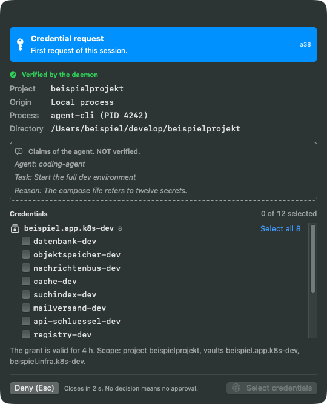
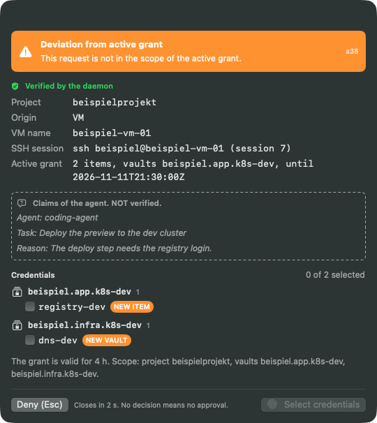
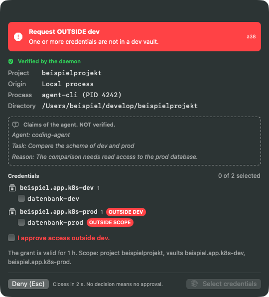

# Spike: Freigabe-UI

## Frage

Der Daemon `a38 serve` startet für jede gebündelte Anfrage eine eigene Freigabe-App.
Die Freigabe-App zeigt ein Popup und liefert eine Entscheidung.
Der Spike beantwortet vier Fragen:

1. Welcher Aufbau und welche Bedienung des Popups verhindern eine versehentliche oder unbedachte Freigabe?
2. Schwebt das Popup unter dem Fenstermanager OmniWM von selbst, oder ist eine Regel für OmniWM nötig?
3. Welches JSON-Protokoll (JSON: JavaScript Object Notation) verwenden Daemon und Freigabe-App?
4. Welche Richtlinie von Touch ID passt, und wie verhält sich Touch ID in den Sonderfällen?

Der Spike enthält einen Wegwerf-Prototyp im Ordner `spikes/ui-popup/`.
Der Prototyp ist kein Produktcode.

## Ergebnis

Die Freigabe-App verwendet ein `NSPanel` mit dem Stil `.nonactivatingPanel`, der Ebene `.floating` und ohne Schließen-Schaltfläche.
Das Popup nimmt dem Benutzer beim Erscheinen den Tastaturfokus nicht weg.
OmniWM 0.8.0 verwaltet dieses Popup nicht: OmniWM kachelt es nicht und verändert weder Position noch Größe.
Eine Regel für OmniWM ist nicht nötig.
Der Benutzer bestätigt nur mit Touch ID über die Richtlinie `.deviceOwnerAuthenticationWithBiometrics`, ohne Rückfall auf das Passwort.
Daemon und Freigabe-App tauschen genau eine Anfrage und genau eine Entscheidung im Schema Version 1 aus, und nur der Exit-Code 0 zusammen mit dem Ergebnis `approved` gilt als Freigabe.

## Aufbau des Popups

### Gemeinsamer Aufbau

Das Popup hat in allen Fällen dieselben Bereiche in derselben Reihenfolge:

1. Banner: Art der Anfrage in Farbe, Symbol und Text.
2. Geprüfte Fakten: Angaben, die der Daemon geprüft hat. Der Bereich trägt ein grünes Schild-Symbol.
3. Angaben des Agenten: Angaben, die der Daemon nicht geprüft hat. Der Bereich hat einen gestrichelten Rahmen, graue kursive Schrift und die Überschrift „NOT verified“.
4. Zugangsdaten: ein Kontrollkästchen je Zugangsdatum, gruppiert nach Vault, mit Zähler „n of m selected“.
5. Freigabe: Gültigkeitsdauer (TTL: Time to live) und Geltungsbereich der Freigabe.
6. Fußzeile: Ablehnen-Schaltfläche links, Restzeit in der Mitte, Bestätigen-Schaltfläche rechts.

Die Texte im Prototyp sind englisch.
Die Sprache der Texte im Produkt ist eine offene Entscheidung.

Die geprüften Fakten hängen von der Herkunft der Anfrage ab:

| Herkunft | Geprüfte Fakten |
| --- | --- |
| Lokaler Prozess | Projekt, Prozessname, Prozessnummer (PID: Process ID), Arbeitsverzeichnis |
| Virtuelle Maschine (VM) | Projekt, Name der VM, SSH-Sitzung (SSH: Secure Shell) |

### Regeln gegen eine versehentliche Freigabe

- Das Popup hat keine Standard-Schaltfläche. Die Eingabetaste hat keine Funktion.
- Das Popup erhält beim Erscheinen keinen Tastaturfokus. Tastatureingaben bleiben in der Anwendung, in der der Benutzer arbeitet.
- Kein Kontrollkästchen ist vorbelegt. Der Benutzer wählt jedes Zugangsdatum selbst aus.
- Die Bestätigen-Schaltfläche ist zuerst gesperrt. Sie wird nach 1,5 Sekunden aktiv, bei einer Anfrage außerhalb von dev nach 3 Sekunden.
- Die Bestätigen-Schaltfläche bleibt gesperrt, solange kein Zugangsdatum ausgewählt ist.
- Die Bestätigen-Schaltfläche reagiert nur auf einen Mausklick. Sie nimmt keinen Tastaturfokus an.
- Touch ID ist der einzige Weg zur Freigabe. Ein Klick allein gibt nichts frei.
- Die Esc-Taste lehnt ab, wenn das Popup den Tastaturfokus hat. Das Popup erhält den Tastaturfokus erst durch einen Klick in das Popup.
- Das Popup hat keine Schließen-Schaltfläche. Die Ablehnen-Schaltfläche ist der einzige Weg, das Popup von Hand zu schließen.
- Die Beschriftung der Bestätigen-Schaltfläche nennt die Anzahl: „Approve 2 with Touch ID“.

Eine versehentliche Freigabe braucht damit mindestens zwei gezielte Mausklicks und einen Fingerabdruck.

### Fall a: erste Anfrage einer Sitzung mit 1 bis 3 Zugangsdaten

Das Banner ist blau.
Die Liste zeigt alle Zugangsdaten vollständig. Die Liste rollt nicht.
Eine Schaltfläche „Select all“ gibt es nicht.

```text
+------------------------------------------------------------+
| [Schlüssel] Credential request                         a38 |   blau
|             First request of this session.                 |
+------------------------------------------------------------+
  [Schild] Verified by the daemon                               grün
  Project    beispielprojekt
  Origin     Local process
  Process    agent-cli (PID 4242)
  Directory  /Users/beispiel/develop/beispielprojekt
+ - - - - - - - - - - - - - - - - - - - - - - - - - - - - - -+
| [?] Claims of the agent. NOT verified.                     |   grau, kursiv
| Agent:  coding-agent                                       |
| Task:   Run the database migration tests                   |
| Reason: The tests need the login for the dev database.     |
+ - - - - - - - - - - - - - - - - - - - - - - - - - - - - - -+
  Credentials                                  0 of 2 selected
  [Vault] beispiel.app.k8s-dev  2
      [ ] datenbank-dev
      [ ] objektspeicher-dev
  The grant is valid for 4 h. Scope: project beispielprojekt,
  vaults beispiel.app.k8s-dev.
--------------------------------------------------------------
  [Deny (Esc)]  Closes in 118 s. No decision   [Select credentials]
                means no approval.              (gesperrt)
```

### Fall b: Bündel mit vielen Zugangsdaten

Bei mehr als 6 Zugangsdaten rollt nur die Liste.
Banner, geprüfte Fakten, Zähler und Fußzeile bleiben sichtbar.
Die Liste gruppiert die Zugangsdaten nach Vault und zeigt die Anzahl je Vault.
Eine Schaltfläche „Select all n“ erscheint nur je Vault, nur für dev-Vaults und nur bei mehr als 3 Zugangsdaten im Vault.
Eine Schaltfläche für alle Vaults zusammen gibt es nicht.



### Fall c: Abweichung von einer bestehenden Freigabe

Das Banner ist orange und trägt den Text „Deviation from active grant“.
Die geprüften Fakten zeigen zusätzlich die bestehende Freigabe mit Anzahl, Vaults und Ablaufzeit.
Die Liste zeigt nur die Zugangsdaten, die von der bestehenden Freigabe abweichen.
Jedes Zugangsdatum trägt eine Marke mit der Art der Abweichung, zum Beispiel „NEW ITEM“ oder „NEW VAULT“.



### Fall d: Anfrage außerhalb von dev

Das Banner ist rot und trägt den Text „Request OUTSIDE dev“.
Der Vault und das Zugangsdatum außerhalb von dev tragen rote Marken.
Der Benutzer setzt zusätzlich das Kontrollkästchen „I approve access outside dev“.
Die Bestätigen-Schaltfläche wird erst nach 3 Sekunden aktiv.
Eine Schaltfläche „Select all“ gibt es für diesen Vault nicht.
Die Freigabe-App behandelt jeden Wert des Felds `environment`, der nicht `dev` ist, als außerhalb von dev.



Die Restzeit in den Bildern ist kurz, weil der Prototyp für die Aufnahme nach 5 Sekunden schließt.

### Fall e: Ablehnen und Zeitablauf

- Die Ablehnen-Schaltfläche ist sofort aktiv. Sie hat keine Verzögerung.
- Die Esc-Taste lehnt ab, wenn das Popup den Tastaturfokus hat.
- Die Fußzeile zeigt die Restzeit. Nach Ablauf schließt das Popup mit dem Ergebnis `timeout`.
- Der Text „No decision means no approval“ nennt die Folge des Zeitablaufs.
- Der Benutzer bricht den Dialog von Touch ID ab: Das Popup bleibt offen und zeigt eine Meldung. Der Benutzer bestätigt erneut oder lehnt ab.
- Touch ID ist nicht verfügbar: Die Freigabe-App endet mit dem Ergebnis `error` und dem Fehlercode `auth_unavailable`.
- Der Daemon behandelt jedes Ergebnis außer `approved` als Ablehnung.

## Fensterverhalten unter OmniWM

### Eigenschaften des Popups

| Eigenschaft | Wert im Prototyp |
| --- | --- |
| Klasse | `NSPanel` |
| Stil | `.titled`, `.fullSizeContentView`, `.nonactivatingPanel`, ohne `.closable` |
| Ebene | `.floating` (Wert 3) |
| `isFloatingPanel` | `true` |
| `hidesOnDeactivate` | `false` |
| `collectionBehavior` | `.canJoinAllSpaces`, `.fullScreenAuxiliary` |
| `becomesKeyOnlyIfNeeded` | `true` |
| Anzeige | `orderFrontRegardless()`, ohne Aktivierung der App |
| Aktivierungsrichtlinie der App | `.accessory`, entspricht `LSUIElement` |

### Geprüft

Die Prüfung lief auf macOS 27.2 mit OmniWM 0.8.0 in sechs Läufen des Prototyps mit `--no-auth --auto-close 5`.

- Das Popup ist sichtbar. `CGWindowListCopyWindowInfo` meldet die Ebene 3 und `onscreen`.
- Position und Größe bleiben unverändert. Das Popup behält die Breite 540 und die vom Prototyp gesetzte Position.
- OmniWM führt das Popup nicht in seiner Fensterliste. `omniwmctl query windows` liefert keinen Eintrag für den Prozess des Prototyps. OmniWM verwaltet das Popup also nicht.
- Dasselbe gilt für die Variante mit Schließen-Schaltfläche (`--closable`).
- Das Popup hat nach dem Erscheinen keinen Tastaturfokus (`isKeyWindow` ist `false`). Die App ist nicht aktiv (`NSApp.isActive` ist `false`).
- AppKit meldet für das Popup die Rolle `AXWindow` und die Unterrolle `AXSystemDialog`. Der Prototyp liest diese Werte im eigenen Prozess. Eine Berechtigung für die Accessibility-Schnittstelle (AX) ist dafür nicht nötig.

Der Quelltext von OmniWM 0.8.0 erklärt das Verhalten.
OmniWM entscheidet in zwei Stufen:

1. Zulassung: OmniWM lässt ein Fenster nur dann zur Klassifizierung zu, wenn die Rolle `AXWindow` ist und die Unterrolle `AXStandardWindow`, `AXFullScreenWindow`, `AXDialog` oder `AXFloatingWindow` ist. Alle anderen Unterrollen brauchen eine ausdrückliche Regel.
2. Klassifizierung: OmniWM kachelt ein zugelassenes Fenster nur, wenn es die Unterrolle `AXStandardWindow` und eine aktive Vollbild-Schaltfläche hat. Sonst schwebt das Fenster.

Weitere Sperren in der Zulassung:

- Ein Fenster einer App mit der Aktivierungsrichtlinie `.accessory` ohne Schließen-Schaltfläche braucht eine ausdrückliche Regel.
- Ein Fenster ab der Ebene `statusWindow` (Wert 25) braucht eine ausdrückliche Regel des Benutzers.
- Ein Fenster, das ein Kindfenster eines anderen Fensters ist, bleibt immer unverwaltet.

Das Popup fällt doppelt unter diese Sperren: Die Unterrolle ist `AXSystemDialog`, und die App ist eine `.accessory`-App ohne Schließen-Schaltfläche.
Eine einfache Regel nur mit Bundle-ID überwindet diese Sperren nicht.

### Angenommen

- Die Freigabe-App als `.app`-Bundle mit `LSUIElement` verhält sich wie der Prototyp. Der Prototyp ist eine einzelne ausführbare Datei ohne Bundle-ID.
- AppKit vergibt die Unterrolle `AXSystemDialog`, weil das Panel über der normalen Fensterebene liegt. Der Spike prüft die Ursache nicht.
- Das Popup liegt sichtbar über gekachelten Fenstern, auf allen Arbeitsbereichen und über Vollbild-Apps. Die Messwerte sprechen dafür. Eine Sichtprüfung am Bildschirm fehlt.
- Andere Fenstermanager für macOS (yabai, AeroSpace) verwenden vergleichbare Regeln über Rolle, Unterrolle und Fensterschaltflächen. Der Spike prüft diese Fenstermanager nicht.

### Regel nach Bundle-ID

Eine Regel ist für OmniWM 0.8.0 nicht nötig.
Die lokale Konfiguration liegt in `~/.config/omniwm/settings.toml`.
Regeln stehen dort als Tabellen `[[appRules]]` mit den Feldern `bundleId`, `appNameSubstring`, `titleRegex`, `layout`, `assignToWorkspace`, `minWidth` und `minHeight`.

Eine Regel wird nur nötig, wenn OmniWM das Popup als schwebendes Fenster verwalten soll.
Diese Regel braucht nach der Dokumentation von OmniWM die Bundle-ID, die genaue Rolle, die genaue Unterrolle und ein festes Layout:

```toml
[[appRules]]
bundleId = "<Bundle-ID der Freigabe-App>"
axRole = "AXWindow"
axSubrole = "AXSystemDialog"
layout = "float"
```

OmniWM vergibt das Feld `id` der Regel selbst.
Der Benutzer legt die Regel deshalb im Fenster „App Rules“ von OmniWM oder mit `omniwmctl rule add` an.
Der Spike hat diese Regel nicht angelegt und nicht getestet.

### Fokus

Das Popup nimmt den Tastaturfokus nicht weg.
Gründe:

- Tastatureingaben des Benutzers landen nicht im Popup. Das verhindert die versehentliche Bedienung beim Tippen.
- OmniWM ändert den Fokus und das Layout nicht, weil keine App aktiviert wird.
- Der Dialog von Touch ID ist ein Dialog des Systems. Er gehört nicht zum Fenster der Freigabe-App. Der Spike nimmt an, dass der Dialog keinen Tastaturfokus der Freigabe-App braucht. Diese Annahme ist ungeprüft.

Der Nachteil: Die Ablehnung mit der Esc-Taste braucht zuerst einen Klick in das Popup.

## Touch ID

### Richtlinie

| Richtlinie | Verhalten | Bewertung |
| --- | --- | --- |
| `.deviceOwnerAuthenticationWithBiometrics` | Nur Touch ID. Der Aufruf schlägt fehl, wenn Touch ID nicht verfügbar, nicht eingerichtet oder gesperrt ist. | Empfohlen als Standard |
| `.deviceOwnerAuthenticationWithBiometricsOrCompanion` | Touch ID oder ein gekoppeltes Gerät, zum Beispiel Apple Watch. Verfügbar ab macOS 15. | Wahlweise, standardmäßig aus |
| `.deviceOwnerAuthentication` | Touch ID oder Passwort des Benutzers. Ohne Touch ID fragt das System sofort nach dem Passwort. | Nicht als Standard |

Begründung für den Standard:

- Die Dokumentation von Apple im Header `LAContext.h` rät davon ab, dass Benutzer ihr Konto-Passwort auf Wunsch einer Anwendung eingeben.
- Ein Passwortdialog lässt sich von einem anderen Prozess nachahmen. Ein Fingerabdruck lässt sich nicht abfangen.
- Die Bestätigung an der Apple Watch zeigt den Inhalt des Popups nicht.

### Einstellungen am `LAContext`

- `localizedFallbackTitle = ""` blendet die Schaltfläche „Passwort verwenden“ aus.
- `touchIDAuthenticationAllowableReuseDuration = 0` verhindert, dass ein früherer Fingerabdruck gilt, zum Beispiel vom Entsperren des Geräts.
- `localizedCancelTitle` benennt die Abbrechen-Schaltfläche. Der Prototyp verwendet „Back“.
- Die Freigabe-App ruft `canEvaluatePolicy` direkt vor `evaluatePolicy` auf, weil sich die Verfügbarkeit ändert.

### Text `localizedReason`

Das System setzt den Text in den Satz „<App-Name>“ is trying to <localizedReason>.
Der Text ergänzt also diesen Satz.
Der Text ist kurz und nennt Anzahl und Projekt.
Der Prototyp verwendet: `approve 2 credentials for project beispielprojekt`.
Der Text enthält nur geprüfte Fakten und keine Angaben des Agenten.
Auf einem deutschen System bildet das System einen deutschen Satz. Der genaue deutsche Satzbau ist ein offener Punkt.

### Verhalten in den Sonderfällen

| Fall | Stand | Aussage |
| --- | --- | --- |
| Normalbetrieb, Deckel offen | Geprüft ohne Dialog | `canEvaluatePolicy` meldet auf diesem Mac alle drei Richtlinien als verfügbar. Der Typ ist Touch ID. |
| App mit `LSUIElement` | Angenommen | Der Dialog erscheint auch ohne Dock-Symbol. Der Dialog zeigt den Namen aus dem Bundle. Beim Prototyp zeigt er den Namen der ausführbaren Datei. |
| Deckel geschlossen, Tastatur ohne Touch ID | Angenommen | Die Richtlinie nur mit Touch ID meldet `biometryNotAvailable`. Die Freigabe-App endet mit `auth_unavailable`. Keine Freigabe ist möglich. |
| Deckel geschlossen, Magic Keyboard mit Touch ID | Offen | Ein einzelner Bericht im Entwicklerforum von Apple nennt `canEvaluatePolicy` gleich `false` in diesem Fall. |
| Apple Watch | Offen | Nur die Richtlinie mit „Companion“ lässt die Apple Watch zu. |
| Zeitablauf während des Dialogs | Lücke im Prototyp | Der Prototyp beendet den Dialog nicht. Das Produkt ruft beim Zeitablauf `invalidate()` am `LAContext` auf. |

Der Spike hat keinen echten Dialog von Touch ID ausgelöst.

## JSON-Protokoll

### Ablauf

1. Der Daemon startet die Freigabe-App über einen absoluten Pfad.
2. Der Daemon schreibt genau ein JSON-Objekt auf die Standardeingabe und schließt die Standardeingabe.
3. Die Freigabe-App schreibt genau eine Zeile mit einem JSON-Objekt auf die Standardausgabe und endet.
4. Die Standardfehlerausgabe enthält nur Diagnosetext.

Beide Richtungen enthalten keine Werte von Zugangsdaten.
Die Anfrage enthält nur Kennung, Vault und Titel je Zugangsdatum.
Feldnamen stehen in `snake_case`.
Das Feld `version` ist eine ganze Zahl. Die Freigabe-App lehnt jede andere Version mit `unsupported_version` ab.

### Anfrage

| Feld | Typ | Pflicht | Bedeutung |
| --- | --- | --- | --- |
| `version` | Zahl | ja | Version des Protokolls, derzeit `1` |
| `type` | Text | ja | Immer `approval_request` |
| `request_id` | Text | ja | Kennung der Anfrage. Die Entscheidung wiederholt sie. |
| `timeout_seconds` | Zahl | nein | Zeit bis zum Ergebnis `timeout`. Standard: 120 |
| `verified.origin` | Text | ja | `local` oder `vm` |
| `verified.project` | Text | ja | Projekt |
| `verified.peer_pid`, `verified.process`, `verified.cwd` | Zahl, Text, Text | nein | Fakten für `local` |
| `verified.vm_name`, `verified.ssh_session` | Text | nein | Fakten für `vm` |
| `claims.agent`, `claims.task`, `claims.reason` | Text | nein | Angaben des Agenten, ungeprüft |
| `credentials[].id` | Text | ja | Kennung, eindeutig in der Anfrage |
| `credentials[].vault` | Text | ja | Name des Vaults |
| `credentials[].title` | Text | ja | Titel des Eintrags |
| `credentials[].environment` | Text | ja | `dev` oder ein anderer Wert. Jeder andere Wert gilt als außerhalb von dev. |
| `credentials[].deviation` | Text | nein | `new_item`, `new_vault` oder `outside_scope` |
| `grant.ttl_seconds` | Zahl | ja | Gültigkeitsdauer der Freigabe |
| `grant.scope.project`, `grant.scope.vaults` | Text, Liste | ja | Geltungsbereich der Freigabe |
| `existing_grant` | Objekt | nein | Bestehende Freigabe mit `grant_id`, `expires_at`, `scope`, `item_count`. Das Feld kennzeichnet eine Abweichung. |

Beispiel:

```json
{
  "version": 1,
  "type": "approval_request",
  "request_id": "req-a-0001",
  "timeout_seconds": 120,
  "verified": {
    "origin": "local",
    "project": "beispielprojekt",
    "peer_pid": 4242,
    "process": "agent-cli",
    "cwd": "/Users/beispiel/develop/beispielprojekt"
  },
  "claims": {
    "agent": "coding-agent",
    "task": "Run the database migration tests",
    "reason": "The tests need the login for the dev database."
  },
  "credentials": [
    { "id": "c1", "vault": "beispiel.app.k8s-dev", "title": "datenbank-dev", "environment": "dev" },
    { "id": "c2", "vault": "beispiel.app.k8s-dev", "title": "objektspeicher-dev", "environment": "dev" }
  ],
  "grant": {
    "ttl_seconds": 14400,
    "scope": { "project": "beispielprojekt", "vaults": ["beispiel.app.k8s-dev"] }
  }
}
```

### Entscheidung

| Feld | Typ | Bedeutung |
| --- | --- | --- |
| `version` | Zahl | Version des Protokolls |
| `type` | Text | Immer `approval_decision` |
| `request_id` | Text | Kennung aus der Anfrage. Das Feld fehlt, wenn die Anfrage nicht lesbar ist. |
| `outcome` | Text | `approved`, `denied`, `timeout` oder `error` |
| `approved_credential_ids` | Liste | Ausgewählte Kennungen. Die Liste ist leer bei jedem Ergebnis außer `approved`. |
| `ttl_seconds` | Zahl | Gültigkeitsdauer der Freigabe, nur bei `approved` |
| `auth.policy` | Text | `biometrics`, `biometrics_or_companion`, `owner` oder `skipped` |
| `auth.ok` | Wahrheitswert | Ergebnis der Authentifizierung |
| `error.code` | Text | `invalid_request`, `unsupported_version`, `auth_unavailable`, `auth_failed` oder `internal` |
| `error.message` | Text | Diagnosetext |
| `elapsed_ms` | Zahl | Zeit vom Start bis zur Entscheidung |

Beispiel für eine Freigabe:

```json
{"approved_credential_ids":["c1"],"auth":{"ok":true,"policy":"biometrics"},"elapsed_ms":8421,"outcome":"approved","request_id":"req-a-0001","ttl_seconds":14400,"type":"approval_decision","version":1}
```

Beispiel für einen Zeitablauf, Ausgabe des Prototyps:

```json
{"approved_credential_ids":[],"elapsed_ms":5028,"outcome":"timeout","request_id":"req-a-0001","type":"approval_decision","version":1}
```

### Exit-Codes

| Exit-Code | Ergebnis | Bedeutung |
| --- | --- | --- |
| 0 | `approved` | Freigabe |
| 10 | `denied` | Der Benutzer lehnt ab. |
| 11 | `timeout` | Zeitablauf ohne Entscheidung |
| 12 | `error` | Touch ID schlägt fehl oder ist nicht verfügbar. |
| 64 | keine Ausgabe oder `error` | Fehler im Aufruf |
| 65 | `error` | Die Anfrage ist ungültig oder hat eine andere Version. |
| 70 | `error` | Interner Fehler |

Regeln für den Daemon:

- Der Daemon wertet nur dann eine Freigabe, wenn der Exit-Code 0 ist, das Ergebnis `approved` ist und `request_id` zur Anfrage passt.
- Der Daemon prüft, dass `approved_credential_ids` eine Teilmenge der angefragten Kennungen ist.
- Der Daemon behandelt jeden anderen Fall als Ablehnung. Dazu gehören ein Absturz, ein Signal, eine leere Ausgabe und ungültiges JSON.
- Der Daemon beendet die Freigabe-App nach einer eigenen Frist, die länger als `timeout_seconds` ist.

## Empfehlung

Der Entwurfslauf hält die folgenden Punkte fest.

### Entscheidungen

- Das Popup ist ein `NSPanel` mit `.nonactivatingPanel`, Ebene `.floating`, ohne Schließen-Schaltfläche, in einer App mit `LSUIElement`.
- Das Popup nimmt den Tastaturfokus nicht weg.
- Das Popup hat keine Standard-Schaltfläche, keine vorbelegten Kontrollkästchen und eine Verzögerung von 1,5 Sekunden, außerhalb von dev von 3 Sekunden.
- Touch ID ist der einzige Weg zur Freigabe. Die Richtlinie ist `.deviceOwnerAuthenticationWithBiometrics`.
- Ohne Touch ID gibt es keine Freigabe. Der Daemon meldet dem Agenten eine Ablehnung mit Grund.
- Eine Abweichung und eine Anfrage außerhalb von dev haben eigene Farben, eigene Texte und eigene Marken. Eine Anfrage außerhalb von dev verlangt ein zusätzliches Kontrollkästchen.
- Das Protokoll hat die Version 1 mit den Feldern aus diesem Dokument. Nur Exit-Code 0 mit `approved` ist eine Freigabe.
- Die Freigabe-App leitet die Darstellung aus den Daten ab: `existing_grant` kennzeichnet die Abweichung, `environment` kennzeichnet den Bereich. Ein eigenes Feld für die Art der Anfrage gibt es nicht.

### Lücken

- Die Sprache der Texte im Popup ist offen.
- Der Benutzer kann die Gültigkeitsdauer im Popup nicht verkürzen. Das Protokoll lässt das zu, weil die Entscheidung `ttl_seconds` enthält.
- Eine Ablehnung für die ganze Sitzung fehlt. Der Benutzer lehnt jede Anfrage einzeln ab.
- Eine Bedienung nur mit der Tastatur fehlt, weil das Popup den Tastaturfokus nicht nimmt.
- Der Daemon prüft die Freigabe-App vor dem Start nicht. Das Produkt prüft den Pfad und die Code-Signatur.
- Der Wert `environment` kommt vom Daemon. Die Regel, die einen Vault als dev einstuft, ist nicht festgelegt.
- Eine Richtlinie für den Betrieb mit geschlossenem Deckel fehlt.

### Risiken

- Freigabemüdigkeit: Viele Popups führen zu Klicks ohne Lesen. Gegenmittel sind das Bündeln im Daemon, eine Obergrenze für Anfragen je Sitzung und Zeit und der sichtbare Unterschied der Fälle c und d.
- Lange Bündel: Niemand liest 12 Zeilen. Die Schaltfläche „Select all n“ je Vault senkt den Aufwand, fördert aber das Bestätigen ohne Lesen. Der Entwurfslauf entscheidet, ob es eine Obergrenze je Bündel gibt.
- Nachahmung: Ein anderer lokaler Prozess zeigt ein gleich aussehendes Fenster. Dieses Fenster erzeugt keine Entscheidung, weil der Daemon nur die Standardausgabe des Prozesses liest, den er selbst startet. Ein anderer Prozess startet die echte Freigabe-App mit einer eigenen Anfrage: Die Entscheidung geht an diesen Prozess und nicht an den Daemon.
- Angaben des Agenten: Der Agent schreibt in `task` und `reason` beliebigen Text. Das Popup kürzt diese Texte auf 3 Zeilen und zeigt sie nie im Bereich der geprüften Fakten und nie im Dialog von Touch ID.
- Unterrolle: Eine neue Version von macOS oder von OmniWM ändert die Unterrolle oder die Zulassung. Dann kachelt OmniWM das Popup möglicherweise. Die Regel aus dem Abschnitt „Regel nach Bundle-ID“ ist das Gegenmittel.

## Offene Punkte

Die folgenden Prüfungen braucht Stefan am Bildschirm.
Alle Befehle laufen im Ordner des Prototyps:

```sh
cd spikes/ui-popup
swift build
```

1. Sichtprüfung unter OmniWM.

    ```sh
    .build/debug/approval-popup --no-auth --auto-close 30 --debug-window < samples/b-bundle-many.json
    omniwmctl query windows --format table
    ```

    Prüfen: Das Popup liegt über den gekachelten Fenstern. Die gekachelten Fenster ordnen sich nicht neu. Das Popup bleibt beim Wechsel des Arbeitsbereichs sichtbar. Das Popup liegt über einer Vollbild-App. OmniWM zeichnet keinen Rahmen um das Popup. Die Fensterliste von OmniWM enthält das Popup nicht.

2. Fokus und Tastatur.

    ```sh
    sleep 3; .build/debug/approval-popup --no-auth --auto-close 30 < samples/a-first-request.json; echo "exit=$?"
    ```

    Prüfen: Nach dem Start in einem anderen Fenster tippen. Die Eingaben bleiben in diesem Fenster. Die Eingabetaste und die Leertaste lösen im Popup nichts aus. Nach einem Klick in das Popup lehnt die Esc-Taste ab, und der Exit-Code ist 10.

3. Vergleich mit Tastaturfokus.

    ```sh
    .build/debug/approval-popup --no-auth --auto-close 30 --take-focus < samples/a-first-request.json
    ```

    Prüfen: Reaktion von OmniWM auf den Fokuswechsel. Verhalten der Esc-Taste ohne Klick.

4. Echter Dialog von Touch ID.

    ```sh
    .build/debug/approval-popup < samples/a-first-request.json; echo "exit=$?"
    ```

    Prüfen: Der Dialog erscheint, obwohl das Popup keinen Tastaturfokus hat. Wortlaut des Satzes mit `localizedReason` auf dem deutschen System. Angezeigter Name der App. Die Schaltfläche „Passwort verwenden“ fehlt. Nach „Back“ bleibt das Popup offen. Nach dem Fingerabdruck steht `approved` in der Ausgabe, und der Exit-Code ist 0.

5. Deckel geschlossen mit externer Tastatur.

    ```sh
    .build/debug/approval-popup --no-auth --auto-close 5 --debug-window < samples/a-first-request.json
    .build/debug/approval-popup < samples/a-first-request.json; echo "exit=$?"
    .build/debug/approval-popup --auth-policy owner < samples/a-first-request.json; echo "exit=$?"
    ```

    Prüfen: Das Feld `auth` in der Zeile `window-debug` zeigt die Verfügbarkeit je Richtlinie. Der zweite Befehl endet mit `auth_unavailable` und Exit-Code 12. Der dritte Befehl fragt nach dem Passwort.

6. Apple Watch.

    ```sh
    .build/debug/approval-popup --auth-policy biometrics_or_companion < samples/a-first-request.json
    ```

    Prüfen: Der Dialog bietet die Apple Watch an. Text auf der Apple Watch.

7. Fälle c und d.

    ```sh
    .build/debug/approval-popup --no-auth --auto-close 30 < samples/c-deviation.json
    .build/debug/approval-popup --no-auth --auto-close 30 < samples/d-outside-dev.json
    ```

    Prüfen: Die Fälle sind auf einen Blick unterscheidbar. Die Verzögerung von 3 Sekunden im Fall d ist spürbar, aber nicht störend.

Weitere offene Punkte ohne Befehl:

- Der Spike hat kein `.app`-Bundle gebaut. Das Verhalten mit Bundle-ID, `LSUIElement` und Code-Signatur ist ungeprüft.
- Der Spike hat die Unterrolle nur im eigenen Prozess gelesen. Eine Abfrage von außen braucht eine Berechtigung für die Accessibility-Schnittstelle.
- Der Spike hat die Regel für OmniWM nicht angelegt und nicht getestet.
- Das Verhalten mit mehreren Bildschirmen ist ungeprüft. Der Prototyp zeigt das Popup auf dem Bildschirm mit dem Mauszeiger.

## Quellen

- OmniWM, Quelltext der Version 0.8.0 (Commit `bf118cc`): <https://github.com/BarutSRB/OmniWM>
    - `README.md`, Abschnitt „App Rules“
    - `Sources/OmniWM/Core/Rules/WindowEligibilityPolicy.swift`
    - `Sources/OmniWM/Core/Rules/WindowRuleEngine.swift`
    - `Sources/OmniWM/Core/Rules/CompiledWindowRule.swift`
    - `Sources/OmniWM/Core/Ax/AXWindowService+Facts.swift`
- OmniWM, Versionshinweise: <https://newreleases.io/project/github/BarutSRB/OmniWM/release/v0.5.2>
- Lokale Konfiguration von OmniWM: `~/.config/omniwm/settings.toml` (nur gelesen)
- Apple, Header `LocalAuthentication.framework/Headers/LAContext.h` im macOS-SDK 27.2
- Apple, Dokumentation zu `LAPolicy.deviceOwnerAuthenticationWithBiometrics`: <https://developer.apple.com/documentation/localauthentication/lapolicy/deviceownerauthenticationwithbiometrics>
- Apple, Dokumentation zu `LAPolicy.deviceOwnerAuthenticationWithCompanion`: <https://developer.apple.com/documentation/localauthentication/lapolicy/deviceownerauthenticationwithcompanion>
- Apple, Entwicklerforum, Beiträge zu LocalAuthentication: <https://developer.apple.com/forums/tags/localauthentication>
- Prototyp: `spikes/ui-popup/`, Messungen mit `CGWindowListCopyWindowInfo`, `omniwmctl query windows` und `screencapture -l`
