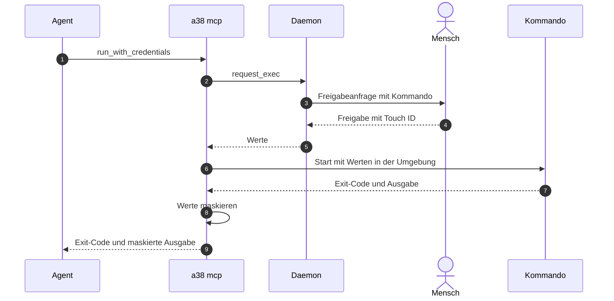

# Befehl mit Zugangsdaten ausführen lassen

Ein Agent braucht für ein Kommando oft ein Zugangsdatum, zum Beispiel das Passwort für `psql`.
Mit dem MCP-Werkzeug `run_with_credentials` startet `a38 mcp` das Kommando für ihn.
Das Kommando erhält den Wert als Umgebungsvariable.
Der Agent erhält nur den Exit-Code und die Ausgabe, nie den Wert ({{ ref("UC15") }}, {{ ref("D61") }}).
Diese Anleitung zeigt, wie der Agent das Werkzeug nutzt und was du dabei siehst.

## Welcher Weg wann gilt

Der Skill aus `a38 llm --skill` gibt dem Agent die Regeln ({{ ref("D68") }}).

| Umgebung des Vaults | `run_with_credentials` | `request_credentials` |
|---|---|---|
| dev | bevorzugt | nur, wenn kein einzelnes Kommando den Wert nutzen kann |
| test | einziger Weg | Antwort `exec_required` |
| prod | einziger Weg, jedes Kommando braucht eine neue Freigabe | Antwort `exec_required` |

Bei `exec_required` stellt der Agent dieselbe Aufgabe einmal mit `run_with_credentials`.
Einen anderen Weg sucht er nicht.

## Voraussetzungen

- `a38` ist als MCP-Server angemeldet ([a38 als MCP-Server anmelden](22-mcp-server-anmelden.md)).
- Der Skill ist installiert ([Skill für Agents installieren](20-skill-installieren.md)).
  Nach einem Update von `a38` installierst du ihn neu. Erst dann kennt der Agent `run_with_credentials`.
- Die Konfiguration nennt die Umgebung der Vaults ([Konfiguration anlegen und ändern](26-konfiguration-anlegen-und-aendern.md)).
- `a38 serve` läuft.

## Ablauf



Gilt ein passender Grant, entfallen die Schritte 3 und 4.

## Die Parameter

| Parameter | Pflicht | Bedeutung |
|---|---|---|
| `command` | ja | Das Programm, zum Beispiel `psql`. Kein Text für eine Shell. |
| `args` | nein | Die Argumente als Liste von Zeichenketten. Nie ein Wert. |
| `env` | ja | Name der Umgebungsvariable → Referenz `op://vault/item/field`. |
| `cwd` | nein | Das Arbeitsverzeichnis. Es liegt im Projekt. Standard: das Arbeitsverzeichnis des Agents. |
| `timeout_seconds` | nein | Die Zeitgrenze in Sekunden. Standard: 120. |
| `task` | ja | Was der Agent tut. Ein kurzer Satz. |
| `reason` | ja | Warum das Kommando die Zugangsdaten braucht. Ein kurzer Satz. |

## Beispiel

Der Agent prüft die Verbindung zur Datenbank in test:

```json
{
  "command": "psql",
  "args": ["-h", "datenbank-test.beispiel.invalid", "-U", "beispielprojekt", "-c", "select 1"],
  "env": {"PGPASSWORD": "op://beispiel.app.k8s-test/datenbank-test/password"},
  "task": "Verbindung zur Datenbank in test prüfen.",
  "reason": "psql braucht das Passwort der Datenbank."
}
```

Braucht der Agent eine Shell, startet er `sh` mit `-c` und nennt die Variable, nicht den Wert:

```json
{
  "command": "sh",
  "args": ["-c", "psql -c 'select 1' | head -n 5"],
  "env": {"PGPASSWORD": "op://beispiel.app.k8s-test/datenbank-test/password"},
  "task": "Verbindung zur Datenbank in test prüfen.",
  "reason": "psql braucht das Passwort der Datenbank."
}
```

Jedes solche Kommando braucht seine eigene Freigabe.

## Das Ergebnis

Das Ergebnis hat die Felder `exit_code`, `timed_out`, `stdout`, `stderr`, `stdout_truncated`, `stderr_truncated` und `masked`.

- Ein Exit-Code ungleich 0 ist ein Ergebnis, kein Fehler von a38. Der Agent liest die Ausgabe und arbeitet weiter.
- `[masked:PGPASSWORD]` in der Ausgabe ersetzt den Wert der Variable `PGPASSWORD`.
- stdin ist leer. Interaktive Kommandos laufen nicht.
- Die Ausgabe behält die letzten 64 KiB je Strom.

## Was du in der Freigabeanfrage prüfst

Die Freigabeanfrage zeigt das volle Kommando ({{ ref("D65") }}).
Prüfe vor der Freigabe:

- Passt das Programm zur Aufgabe?
- Gibt das Kommando die Variable aus, zum Beispiel mit `printenv`, `echo "$PGPASSWORD"` oder `base64`? Dann lehne ab.
  Die Maskierung erkennt nur den exakten Wert ({{ ref("RI13") }}).
- Stehen die Argumente ohne Wert da?

## Ein Wert im Kommando

Ein Wert gehört nie in ein Argument oder in das Arbeitsverzeichnis.
Der Skill verbietet das.
Der Daemon prüft es nach der Freigabe.
Findet er einen Wert, liefert er nicht aus, und der Agent erhält `invalid_request`.

Diese Prüfung kommt spät; das ist eine bekannte Grenze ({{ ref("G46") }}).
Der Daemon darf einen Wert erst nach der Freigabe lesen.
Schreibt ein Agent trotzdem einen Wert in ein Argument, steht der Wert schon in der Freigabeanfrage.
Er steht auch in den Einträgen `request`, `decision` und `grant` des Audit-Logs ([Kommando im Audit-Log](../reference/80-befehle-fuer-den-menschen.md#kommando-im-audit-log)).
Siehst du einen Wert im Kommando, lehne ab.

## Grants

Ein Grant gilt so lange, wie du es erlaubst ({{ ref("D63") }}).

- In dev kann er einige Stunden gelten.
- In test ist er kurz und gilt nur für dasselbe Programm.
- In prod gibt es keinen Grant. Jedes Kommando braucht eine neue Freigabe.
- Steht die Laufzeit von dev oder test auf `0s`, gilt dort dasselbe wie in prod ({{ ref("D76") }}). Die Freigabeanfrage zeigt dann „Only this command, one time“. In dev antwortet `request_credentials` dann mit `exec_required`.

## Hook gegen op

Der Hook `a38 hook op-guard` blockiert den Aufruf von `op` und nennt `run_with_credentials` und `request_credentials`.
Richte ihn für alle Projekte ein ([Hook gegen den direkten Aufruf von op einrichten](23-hook-gegen-op-einrichten.md)).
