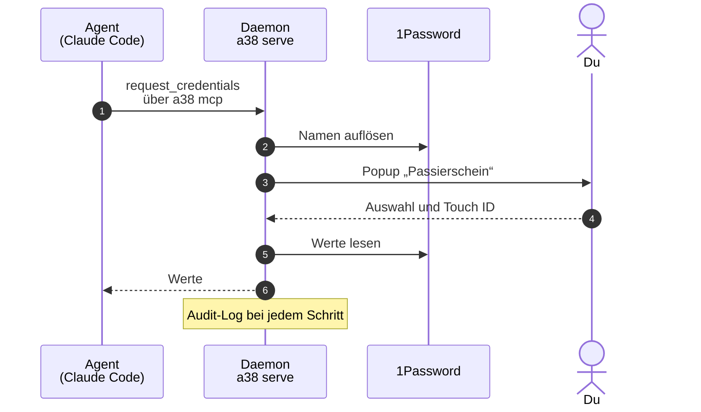
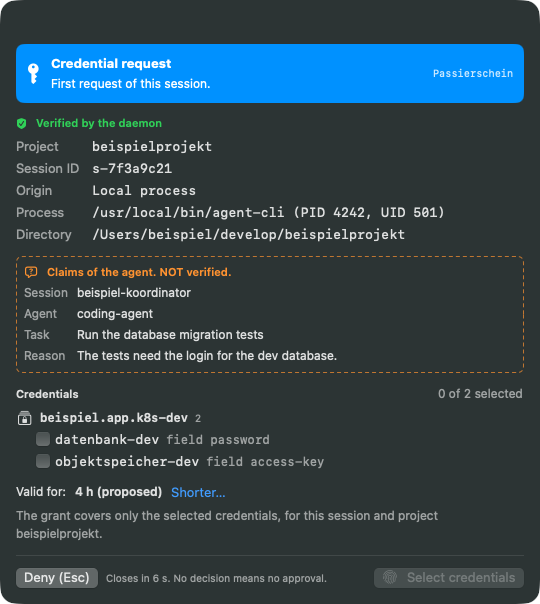
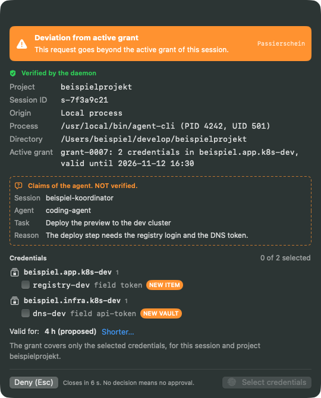
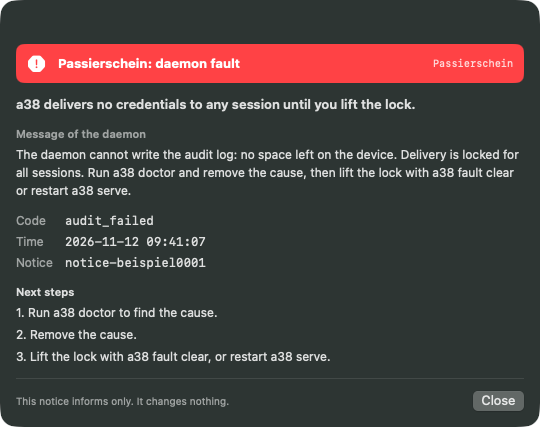

# Live-Demo: Ein Agent fragt, du gibst frei

In diesem Tutorial lässt du einen Coding Agent Zugangsdaten anfordern und entscheidest selbst über jede Freigabe.
Du gehst die Seite von oben nach unten durch.
Jeder Schritt nennt, was du tust, was du siehst und was es bedeutet.
Der Durchgang dauert etwa 10 Minuten.



Am Ende hast du gesehen:

- Der Agent hat keinen Zugang zum Passwortmanager. Er fragt den Daemon.
- Du siehst im Popup, was geprüft ist und was der Agent nur behauptet.
- Eine Freigabe gilt für eine Sitzung, für genau die gewählten Zugangsdaten und für begrenzte Zeit.
- Der Daemon schreibt jeden Schritt in ein Audit-Log.

!!! info "Voraussetzung"
    Die Demo ist aufgebaut: `a38` liegt im `PATH`, die App „Passierschein“ ist installiert, die Konfiguration steht unter `~/.config/a38/config.yaml`, und das Demo-Projekt liegt unter `~/develop/demo-projekt`.
    Den Aufbau mit einem Befehl, die Probe ohne 1Password und die Ausweichwege beschreibt das How-to [Demo vorführen](../how-to/50-demo-vorfuehren.md).
    Alle Werte im Test-Vault `passierschein.dev` sind erfunden.

## Der Bildschirm

Öffne drei Terminals nebeneinander und vergrößere die Schrift.

| Terminal | Rolle | Befehl |
|---|---|---|
| 1 | der Daemon | `a38 serve --backend 1password --ui app` |
| 2 | der Agent | `cd ~/develop/demo-projekt && claude` |
| 3 | du, der Mensch | `a38 doctor` und die Befehle der Schritte |

Kein Befehl braucht `--config`. `a38` liest die Konfiguration am Standardort.

## Schritt 1: Die Regeln ansehen

Zeige in Terminal 3 die Konfiguration:

```sh
cat ~/.config/a38/config.yaml
```

```yaml
vaults:
  - name: passierschein.dev
    environment: dev

projects:
  - name: demo-projekt
    paths:
      - ~/develop/demo-projekt
    vaults:
      - passierschein.dev

grant:
  lifetime: 4h

bundle:
  window: 3s
  max_entries: 10
```

**Was das bedeutet:**

- `vaults`: Nur diese Vaults existieren für `a38`. Nur ein Vault der Umgebung `dev` liefert heute Werte ({{ ref("D12") }}, {{ ref("D47") }}).
- `projects`: Das Arbeitsverzeichnis des Agents bestimmt das Projekt. Ein Projekt nutzt nur die Vaults, die es nennt ({{ ref("D28") }}).
- `grant`: Eine Freigabe gilt höchstens vier Stunden ({{ ref("D32") }}).
- `bundle`: Anfragen einer Sitzung innerhalb von drei Sekunden landen in einem Popup ({{ ref("D29") }}).

Zeige danach, wie der Agent an `a38` kommt:

```sh
cat ~/develop/demo-projekt/.mcp.json
a38 llm --skill | head -20
```

`.mcp.json` meldet `a38 mcp` im Projekt an und nennt die Sitzung `demo-praesentation`.
Der Skill sagt dem Agent, wie er fragt und dass er nach einem Nein aufhört ({{ ref("D22") }}).

## Schritt 2: Den Daemon starten und prüfen

Starte in Terminal 1 den Daemon:

```sh
a38 serve --backend 1password --ui app
```

```text
level=INFO msg="approval app chosen" path=/Users/…/Applications/Passierschein.app/Contents/MacOS/Passierschein
level=INFO msg="daemon started" backend=1password ui=app …
level=INFO msg="the 1password backend works" vaults_configured=1 vaults_visible=1
```

Prüfe in Terminal 3 den Zustand:

```sh
a38 doctor
```

```text
OK       configuration      loaded, 1 projects, 1 vaults
OK       socket modes       directory 0700, sockets 0600
OK       daemon             version …, 0 sessions, 0 grants
OK       delivery lock      delivery is open
OK       audit file         …/audit.db exists and is writable
OK       audit chain        intact, … entries
OK       backend            ok
OK       1password token    …: regular file of the user, mode 0600 (content not read; …)
OK       approval UI        mode app, …/Passierschein

No findings.
```

**Was das bedeutet:** Nur der Daemon hat Zugang zu 1Password ({{ ref("D1") }}).
Ein Befehl zeigt, ob alles bereit ist ({{ ref("F20") }}).

## Schritt 3: Der Agent braucht den Datenbank-Login

Starte in Terminal 2 den Agent und gib ihm die Aufgabe:

```sh
cd ~/develop/demo-projekt && claude
```

> Führe die Datenbank-Migration aus (./migrate.sh). Die Zugangsdaten bekommst du über a38.

Der Agent ruft das Werkzeug `request_credentials` auf, mit dem Benutzer und dem Passwort der Datenbank in einer Anfrage.
Nach drei bis sechs Sekunden erscheint das Popup.

{ width="420" }

Das Bild ist ein Beispiel mit dem Projekt `beispielprojekt`. In der Demo stehen dort `demo-projekt` und die Sitzung `demo-praesentation`.

**Lies das Popup von oben nach unten:**

1. **Verified by the daemon** (grün): Projekt, Prozess und Verzeichnis. Diese Angaben hat der Daemon selbst geprüft.
2. **Claims of the agent. NOT verified.** (orange): Name der Sitzung, Aufgabe und Begründung. Das behauptet der Agent ({{ ref("D4") }}).
3. **Credentials:** die angeforderten Zugangsdaten. Nichts ist vorab angehakt.

Hake beide Einträge an, klicke auf die Bestätigung und gib mit Touch ID frei ({{ ref("D7") }}).
Die Eingabetaste und die Leertaste lösen nichts aus.

Der Agent startet danach `./migrate.sh`.
Die Ausgabe nennt den Benutzer und nur die Länge des Passworts.

!!! warning "Der Agent zeigt den Wert in seinem Befehl"
    Claude Code zeigt den Befehl, den der Agent ausführt, zum Beispiel `DB_PASSWORD=… ./migrate.sh`.
    Der Wert steht dann in Terminal 2.
    Das ist für Zugangsdaten der Entwicklungsumgebung so entschieden ({{ ref("D9") }}): Sie sind rotierbar, und jede Auslieferung ist protokolliert.

Sieh in Terminal 3 nach, was der Daemon notiert hat:

```sh
a38 audit list
```

```text
SEQ  TYPE      PROJECT       SESSION             REFERENCES                                    RESULT
15   request   demo-projekt  demo-praesentation  op://passierschein.dev/datenbank-dev/username,…  ok
16   bundle    demo-projekt  demo-praesentation  …                                              ok
17   decision  demo-projekt  demo-praesentation  …                                              ok (approved)
18   grant     demo-projekt  demo-praesentation  …                                              ok
19   delivery  demo-projekt  demo-praesentation  …                                              ok
```

**Was das bedeutet:** Der Mensch entscheidet mit Touch ID. Anfrage, Entscheidung, Grant und Auslieferung stehen im Audit-Log, bevor der Wert den Daemon verlässt ({{ ref("D36") }}).

## Schritt 4: Noch einmal fragen, ohne Popup

Gib dem Agent diese Aufgabe:

> Hole die Datenbank-Zugangsdaten noch einmal über a38 und führe die Migration erneut aus.

Es erscheint kein Popup. Die Antwort kommt sofort.
Sieh dir den Grund an:

```sh
a38 grants list
```

Die Liste zeigt einen Grant der Sitzung `demo-praesentation` mit beiden Referenzen und der Restlaufzeit.

**Was das bedeutet:** Ein Grant gilt für diese Sitzung, für genau diese Zugangsdaten und für begrenzte Zeit ({{ ref("D8") }}). Das Audit-Log enthält trotzdem jede Auslieferung.

## Schritt 5: Der Agent will mehr, du lehnst ab

Gib dem Agent diese Aufgabe:

> Lade jetzt das Build-Artefakt hoch (./upload.sh). Den Schlüssel bekommst du über a38.

Der Agent fordert den Schlüssel des Objektspeichers an.
Der Grant deckt ihn nicht ab. Das Popup ist jetzt orange.

{ width="420" }

Das Popup nennt den bestehenden Grant und zeigt nur den neuen Eintrag.
Klicke einmal in das Popup und drücke `Esc`.

Der Agent erhält `denied`. Er hört auf und sagt dir, dass du abgelehnt hast.

**Was das bedeutet:** Was über eine Freigabe hinausgeht, fällt auf. Nach einem Nein sucht der Agent keinen anderen Weg; so steht es im Skill.

## Schritt 6: Einen Grant widerrufen

Widerrufe den Grant aus Schritt 4:

```sh
a38 grants list
a38 grants revoke <grant-id>
```

Gib dem Agent diese Aufgabe:

> Führe die Migration noch einmal aus. Hole die Zugangsdaten dafür frisch über a38.

Das Popup erscheint wieder. Gib frei oder lehne ab.

**Was das bedeutet:** Du beendest eine Freigabe jederzeit ({{ ref("D33") }}). Der Widerruf gilt für künftige Abrufe. Einen Wert, den der Agent schon hat, holt er nicht zurück; dafür ist die Rotation in 1Password da ({{ ref("RI11") }}).

!!! tip "Variante: nur einen Teil freigeben"
    Hake im Popup nur `username` an.
    Der Agent erhält nur den Benutzernamen. Für das Passwort meldet `a38` den Code `denied`.

## Schritt 7: Ein Vault außerhalb der Regeln

Gib dem Agent diese Aufgabe:

> Fordere über a38 den Wert op://beispiel.app.k8s-prod/datenbank-prod/password an. Ich will zeigen, was dann passiert.

Es erscheint kein Popup. Der Agent erhält `not_allowed`.

```sh
a38 audit list --type denial
```

**Was das bedeutet:** Die Policy lehnt ab, bevor ein Mensch gefragt wird ({{ ref("D28") }}). Der Agent erfährt nicht, ob es den Vault gibt.

## Schritt 8 (optional): Eine Störung

Dieser Schritt zeigt, was geschieht, wenn der Daemon nicht mehr protokollieren kann.
Die Befehle mit `mise run` laufen im Klon des Repos.

1. Nimm dem Audit-Log das Schreibrecht:

    ```sh
    mise run demo:fault
    ```

2. Gib dem Agent zweimal nacheinander diese Aufgabe:

    > Hole die Datenbank-Zugangsdaten neu über a38 und führe die Migration noch einmal aus.

    Die erste Anfrage endet mit `audit_failed`. Die App zeigt eine Meldung:

    { width="420" }

    Die zweite Anfrage endet mit `daemon_faulted`. Das gilt jetzt für jede Sitzung.

3. Finde die Ursache:

    ```sh
    a38 doctor
    a38 fault status
    ```

4. Behebe die Ursache und hebe die Sperre selbst auf:

    ```sh
    mise run demo:fault:fix
    a38 fault clear
    ```

5. Gib dem Agent die Aufgabe noch einmal und gib frei. Prüfe danach die Kette:

    ```sh
    a38 audit verify
    ```

    ```text
    The chain is intact: … entries.
    ```

**Was das bedeutet:** Ohne Eintrag im Audit-Log gibt es keine Auslieferung ({{ ref("D36") }}). Bei einer Störung sperrt der Daemon für alle Sitzungen, und nur der Mensch hebt die Sperre auf ({{ ref("D48") }}).

## Was du gesehen hast

| Schritt | Aussage |
|---|---|
| 1 | Die Regeln stehen in einer lesbaren Datei. |
| 2 | Nur der Daemon hat Zugang zum Passwortmanager. |
| 3 | Der Mensch sieht geprüfte Fakten und Behauptungen getrennt und entscheidet mit Touch ID. |
| 4 | Ein Grant gilt für eine Sitzung, bestimmte Zugangsdaten und begrenzte Zeit. |
| 5 | Eine Abweichung fällt auf. Nach einem Nein hört der Agent auf. |
| 6 | Der Mensch widerruft jederzeit. |
| 7 | Die Policy lehnt ab, bevor ein Mensch gefragt wird. |
| 8 | Ohne Audit-Log keine Auslieferung. |

## Was noch fehlt

- Das Release ist noch nicht signiert und notarisiert. Die App ist ad hoc signiert ({{ ref("G5") }}).
- Das Token des Service Accounts liegt noch in einer Datei. Der Weg in den Schlüsselbund ist in Prüfung ({{ ref("D51") }}).
- Der Betrieb mit Agents in einer VM und die TUI für die Auswertung fehlen noch ({{ ref("F17") }}, {{ ref("F13") }}).

## Wie es weitergeht

- [Demo vorführen](../how-to/50-demo-vorfuehren.md): Aufbau, Probe, Ausweichwege ohne Agent und Abbau.
- [Erste Schritte mit a38](10-erste-schritte.md): derselbe Ablauf mit dem Fake-Backend, ohne 1Password und ohne Popup.
- [Design](../design/index.md): die Entscheidungen hinter jedem Schritt.
